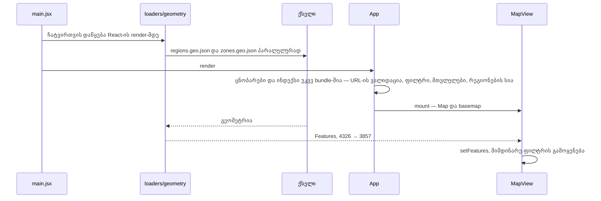

# 01 — არქიტექტურა
საქართველოს ღვინის რუკა · v1
ბოლო განახლება: 2026-11-18 (ეტაპი 8: bottom sheet, კლავიატურა, მოძრაობა)
სტატუსი: პროექტი. §10-ის პუნქტები დადასტურებამდე წინადადებად ითვლება.

---

## 1. პრინციპები

1. **სამი ფენა, ცალმხრივი დამოკიდებულება.** `components/ → state/ → domain/` და ცალკე `components/MapView → map/`. `domain/` არაფერს აიმპორტებს React-იდან ან ol-იდან, `map/` კი React-იდან. ამიტომ ფილტრის ლოგიკა Vitest-ით DOM-ისა და canvas-ის გარეშე ტესტდება.
2. **ფილტრის ერთადერთი წყარო URL-ია** (§5).
3. **მონაცემი უცვლელია.** ერთხელ იტვირთება და runtime-ში არ იცვლება. შესაბამისი ზონები და მთვლელები მისგან და URL-იდან გამოითვლება, არსად ინახება.
4. **რუკა იმპერატიულია, UI დეკლარაციული.** მათ შორის ერთი ხიდია, `MapView`. ol-ის ობიექტები React state-ში არ ხვდება.
5. **რუკის ყოველ მოქმედებას DOM-ში აქვს ეკვივალენტი** (რეგიონების სია, ფილტრი, ღილაკები), რადგან canvas ეკრანის წამკითხველისთვის და კლავიატურისთვის მიუწვდომელია. WCAG 2.2 AA. **ეტაპ 8:** რუკის კონტეინერი თავადაც ერთი კლავიატურული tab stop-ია (ისრები, zoom, ზონებზე გადასვლა), მაგრამ ეს ეკვივალენტს არ ანაცვლებს: სია რჩება მთავარ გზად.
6. **UI-ის ყველა ტექსტი ერთ ფაილშია** (`src/copy/ka.js`), რომ ინგლისური ვერსია მოგვიანებით ახალი ფაილის დამატება იყოს და არა რეფაქტორი.

---

## 2. ფაილების ხე

```
map_2/
├── index.html
├── package.json
├── vite.config.js                # Vite + Vitest (test ველი, ცალკე config-ის გარეშე)
├── eslint.config.js              # Vite-ის შაბლონიდან
├── netlify.toml | vercel.json    # ჰოსტინგი, header-ები; არჩევანი ეტაპ 9-ზე
├── scripts/                      # მონაცემების აწყობა და ვალიდაცია (ჩატი 3); bundle-ში არ შედის
├── public/
│   └── favicon.svg
└── src/
    ├── main.jsx                  # entry: CSS, StrictMode, გეომეტრიის ჩატვირთვის დაწყება
    ├── App.jsx                   # layout და პანელის მასპინძელი; ეტაპი 7: MapContext provider, useZoneSelection; ეტაპი 8: რეჟიმი (სია / ფილტრი / ზონა), sheet-ის სიმაღლე, ფოკუსი, ფილტრის live რეგიონი, მობილურის ფილტრის ღილაკი
    ├── App.module.css            # ბადე: მობილურზე ერთი უჯრა, desktop-ზე ორი სვეტი; --map-inset-bottom sheet-ის მდგომარეობით (data-sheet); ზედა ზოლი
    │
    ├── styles/
    │   ├── tokens.css            # ჩატი 2 — ფერის, spacing-ის, radius-ის, შრიფტის ერთადერთი წყარო
    │   └── global.css            # reset, საბაზისო ტიპოგრაფია, .map-button, ol.css-ის override-ები
    │
    ├── copy/
    │   └── ka.js                 # UI-ის ყველა სტრიქონი (04-copy-voice.md); ეტაპი 8: sheet, filter.button, map.keyboard
    │
    ├── data/                     # ჩატი 3-ის შედეგი; აპისთვის მხოლოდ წასაკითხი
    │   ├── styles.json           # სტილების ცნობარი: slug, UI-ის სახელი, სინონიმები
    │   ├── grapes.json           # ჯიშების ცნობარი
    │   ├── regions.json          # რეგიონების ატრიბუტები (გეომეტრიის გარეშე)
    │   ├── zones.json            # ზონების ინდექსი: ატრიბუტები + კავშირები (გეომეტრიის გარეშე)
    │   ├── regions.geo.json      # ADM1 გეომეტრია
    │   └── zones.geo.json        # ზონების გეომეტრია (MultiPolygon); ეტაპ 5-ზე placeholder
    │
    ├── loaders/
    │   ├── catalogs.js           # styles, grapes, zones index — სტატიკური import; ეტაპ 6: `zones`, `filterCatalog`; ეტაპ 7: regions, sources, `zonesByRegionId`; ეტაპ 8: `zonesInListOrder`
    │   └── geometry.js           # *.geo.json — fetch hash-იანი URL-ით, promise cache, retry
    │
    ├── domain/                   # სუფთა ფუნქციები: React-ისა და ol-ის გარეშე
    │   ├── filterLogic.js        # ეტაპი 6, ერთ ფაილად: შესაბამისობა (OR/AND), მთვლელები და disabled, ფილტრის ფერი, სინონიმებით ძებნა, URL query ↔ ფილტრი
    │   └── filterLogic.test.js   # Vitest, node გარემო; 23 ტესტი
    │                             # თავდაპირველი გეგმა: filter.js, facets.js, filterParams.js, catalog.js (§3 „ეტაპ 6“, §10)
    │
    ├── state/
    │   ├── useUrlFilters.js      # ეტაპი 6, ერთ ფაილად: history-ის წაკითხვა/ჩაწერა, ფილტრი URL-იდან, წარმოებული შედეგი, toggle/clear; ეტაპი 7: setOnly, hrefForOnly
    │   │                         # თავდაპირველი გეგმა: urlState.js, useFilter.js, useFilterResult.js (§3 „ეტაპ 6“, §10)
    │   └── useSelectedZone.js    # არჩეული ზონა URL-იდან (წინადადება, §5); ჯერ არ არსებობს
    │
    ├── map/                      # მხოლოდ OpenLayers; React-ის გარეშე
    │   ├── createMap.js          # Map + View + controls; აბრუნებს რუკის კონტროლერს; ეტაპი 8: interaction-ები reduced motion-ით, setHighlightedZone, revealBBox
    │   ├── basemaps.js           # XYZ კონფიგურაცია: Light, Terrain, Imagery; ეტაპი 8: tile fade-ის გამორთვა
    │   ├── interactions.js       # click → ზონის id (zonesLayer.pickAt); hover შიგნითვე, React-ის გარეშე; ეტაპი 8: გარე მონიშვნა hover-ზე მაღლა
    │   ├── layers/
    │   │   ├── regionsLayer.js
    │   │   └── zonesLayer.js     # ფლობს სტილის მდგომარეობას; ცვლილება → layer.changed()
    │   └── styles/
    │       ├── regionStyle.js
    │       ├── zoneStyles.js     # active / dimmed / selected / hover; პოლიგონი ან ცენტროიდის მარკერი; ლეიბლი, ჩიპი, ნიმუშები
    │       └── mapTokens.js      # tokens.css → getComputedStyle; ეტაპ 4: რეგიონები და motion; ეტაპ 5: zone ჯგუფი
    │
    ├── components/               # თითო ფოლდერში Component.jsx + Component.module.css
    │   ├── MapView/              # MapView.jsx + MapContext.js + useZoneSelection.js; ქმნის კონტროლერს და ავსებს ref-ს (ეტაპ 7-დან ref-ს App ქმნის); state → map-ის ერთადერთი ხიდი; ეტაპი 8: რუკის კონტეინერი tab stop-ია (კლავიშები, კურსორი, სტატუსი)
    │   ├── FilterPanel/          # ეტაპი 6: FilterPanel.jsx + FilterPanel.module.css; შიგთავსი კონტეინერისგან დამოუკიდებელია; ეტაპი 8: headingRef, onClose
    │   ├── ZonePanel/            # ეტაპი 7: ZonePanel.jsx + ZonePanel.module.css; შიგთავსი კონტეინერისგან დამოუკიდებელია; ეტაპი 8: onShowOnMap
    │   ├── RegionList/           # ეტაპი 7: RegionList.jsx + RegionList.module.css; შიგთავსი კონტეინერისგან დამოუკიდებელია; ეტაპი 8: ისრების კლავიშები, რუკაზე მონიშვნა, onShowOnMap
    │   ├── StyleMarker/          # ეტაპი 7: სტილის ნიშანი (ფორმა და ფერი ტოკენებიდან) ZonePanel-ისა და RegionList-ისთვის
    │   ├── BasemapSwitcher/
    │   └── BottomSheet/          # ეტაპი 8: BottomSheet.jsx + BottomSheet.module.css (კონტეინერი: მდგომარეობები, სახელური, გადათრევა; desktop-ზე გვერდითი პანელი) + snapPoints.js (+ .test.js, 7 ტესტი): სუფთა ფუნქციები მდგომარეობის არჩევისთვის
    │
    └── hooks/
        └── useMediaQuery.js      # ეტაპი 8: useMediaQuery(query), useIsDesktop(); მხოლოდ იქ, სადაც ქცევა და არა მხოლოდ ვიზუალი იცვლება
```

**სტილები:** CSS Modules (Vite-ში ჩაშენებულია, დამოკიდებულება არ სჭირდება). ყოველი მნიშვნელობა `tokens.css`-ის ცვლადიდან.

---

## 3. მოდულები

| მოდული | პასუხისმგებლობა | დამოკიდებულებები |
|---|---|---|
| **Map core** · `map/createMap.js` | ქმნის `Map`-ს და `View`-ს (EPSG:3857, საწყისი ხედი საქართველოზე), controls (zoom, attribution), ფენების რიგს zIndex-ით: basemap → რეგიონები → ზონები. აბრუნებს **რუკის კონტროლერს**: `setMatchingZones`, `setSelectedZone`, `setBasemap`, `fitToExtent`, `setFeatures`, `destroy`. React-ს არ იცნობს. **ეტაპ 4-ზე არსებობს:** `setFeatures({ regions })`, `setBasemap(id)`, `fitToExtent(extent, { padding, animate })`, `destroy()` (`setTarget(undefined)` + `dispose()`). View-ს ცენტრი არ აქვს პირველ `fitToExtent`-მდე; zoom 5–15; როტაცია გამორთულია. Zoom და Attribution კონტროლები MapView-ის მიწოდებულ ელემენტებში იხატება (`target`). **ეტაპ 5-ზე დაემატა:** ზონების ფენა (zIndex: basemap 0 → რეგიონები 10 → ზონები 20); `setFeatures({ regions, zones })`; `setZoneAppearance({ matchingIds, colorKeyById })` (§3-ის `setMatchingZones`-ის ნაცვლად); `setSelectedZone(id)`; `onZoneClick(listener)` → გამოწერის გაუქმების ფუნქცია; `setBasemap` ზონების ფენასაც ატყობინებს (სატელიტზე შევსება მკვრივია). `createMap` ფენას `view.getResolutionForZoom(LABEL_MIN_ZOOM)`-ს გადასცემს. `destroy()` ჯერ interaction-ებს ხსნის. **ეტაპ 7-ზე დაემატა:** `fitToBBox(bbox, options)`: `regions.json`-ისა და `zones.json`-ის `bbox` (EPSG:4326) → `transformExtent` → `fitToExtent`; `createMap`-ის პარამეტრი `getFitPadding()`: fit-ის ნაგულისხმევი padding, ყოველ fit-ზე ხელახლა იკითხება. **ეტაპ 8-ზე დაემატა:** `setHighlightedZone(id)` (გარე მონიშვნა hover-ის სტილით, რუკა არ მოძრაობს) და `revealBBox(bbox)` → boolean (fit მხოლოდ მაშინ, თუ extent fit-ის padding-ის შიგნით მთლიანად არ ჩანს). interaction-ებს `createMap` თავად აწყობს `ol/interaction/defaults`-ით: `--motion-duration-map` = 0-ზე `zoomDuration: 0`, `DragPan` ინერციის გარეშე, `KeyboardPan` `duration: 0`; როტაციის interaction-ები გამორთულია. იგივე ნიშანი რთავს-თიშავს Zoom კონტროლის ხანგრძლივობას, View-ს `smoothResolutionConstraint`-ს და tile-ების fade-ს. `matchMedia('(prefers-reduced-motion: reduce)')`-ის `change`-ზე interaction-ები, Zoom კონტროლი და View ხელახლა იქმნება (View იმავე ცენტრითა და რეზოლუციით), ამიტომ `fitToExtent` `map.getView()`-ს კითხულობს და არა დახურულ `view`-ს. OpenLayers კლავიშებს `target` ელემენტზე უსმენს: MapView მას `tabindex` აძლევს. | `ol/Map`, `ol/View`, `ol/control`, `ol/proj`, `ol/extent`, `ol/interaction/*`, `map/basemaps`, `map/layers/*`, `map/interactions` |
| **Basemaps** · `map/basemaps.js` | XYZ წყაროების სია სამი სლოტით (`light`, `terrain`, `imagery`): `id`, `url`, `attribution`, `subdomains`, `maxZoom`, `key { placeholder, env }`. ქართული სახელი `copy/ka.js`-შია (`basemap.names[id]`). `url` და `attribution` სიიდან უცვლელად იწერება; Leaflet-ის `{s}`/`{r}` და გასაღების ჩასმა კოდში ხდება (`buildUrlOptions`). ყველა ფენა ერთხელ იქმნება, გადართვა `setVisible`-ია. ფენები და პირობები: 06-data-sources.md §8. გასაღები `import.meta.env.VITE_*`-დან (ის კლიენტის bundle-ში ჩანს, ამიტომ დომენზე შეზღუდული უნდა იყოს). **ეტაპ 8:** `createBasemapLayers(activeId, { fadeIn })`: `fadeIn: false` (reduced motion) `XYZ`-ს `transition: 0`-ს აძლევს; იკითხება გვერდის ჩატვირთვისას. | `ol/layer/Tile`, `ol/source/XYZ` |
| **Layers** · `map/layers/regionsLayer.js` | ADM1 vector ფენა. ცალკე სტილის მდგომარეობა (მაგ. ფოკუსში მყოფი რეგიონი). აფხაზეთისა და ცხინვალის რეგიონის ჩვენების წესისთვის ადგილი რჩება (ჩატი 3). | `ol/layer/Vector`, `ol/source/Vector`, `map/styles/regionStyle` |
| **Layers** · `map/layers/zonesLayer.js` | ზონების vector ფენა რეგიონების ზემოთ. ფლობს **სტილის მდგომარეობას** `{ matchingIds, colorKeyById, selectedId, hoveredId, imagery }`. ყოველი ცვლილება: მდგომარეობის განახლება + `layer.changed()`. ფენა და features ხელახლა არ იქმნება. **ეტაპ 5:** `declutter: true`. `setFeatures` შემოსულ Feature-ებს ნორმალიზებს: ერთი id-ის ნაწილებს აერთიანებს, Polygon-ს MultiPolygon-ად აქცევს, ითვლის `labelGeometry`-ს (`labelPoint`; თუ ის ზონის გარეთაა, ყველაზე დიდი ნაწილის შიდა წერტილი), `span`-ს (bbox-ის დიდი გვერდი) და `rank`-ს (0 = ყველაზე დიდი ფართობი). ყოველთვის ახალ Feature-ებს ქმნის კოორდინატებიდან: OpenLayers 10-ში `new MultiPolygon([Polygon…])` წყარო Polygon-ების `ends`-ს ადგილზე ცვლის და StrictMode-ის მეორე გამოძახებაზე გეომეტრია ფუჭდება. `pickAt(coordinate, resolution, tolerancePx)` აბრუნებს ზონების id-ებს საუკეთესო კანდიდატით დასაწყისში: მარკერი (24×24px სამიზნე, უახლოესი ცენტრი) → წერტილის შემცველი ზონები, პატარა ფართობით დაწყებული → ცდომილების ფარგლებში უახლოესი საზღვარი. OpenLayers-ის hit detection არ გამოიყენება, რომ წესი ყველა მოწყობილობაზე ერთი იყოს. **ეტაპ 8:** ფენა არ შეცვლილა; `hoveredId`-ს ახლა კლავიატურის მონიშვნაც კვებავს (`interactions.js`). | `ol/Feature`, `ol/extent`, `ol/geom/*`, `ol/layer/Vector`, `ol/source/Vector`, `map/styles/zoneStyles` |
| **Layers** · `map/styles/zoneStyles.js` | style function: აქტიური / ჩამქრალი / არჩეული / hover. ეკრანზე პატარა ზონას (bbox პიქსელებში ზღვარზე ნაკლები) ხატავს **ცენტროიდის მარკერად** იმავე feature-ზე, `labelPoint`-იდან. Style ობიექტების cache. **ეტაპ 5:** ზღვარი `2 × --map-marker-hit-radius` (24px) bbox-ის დიდ გვერდზე; `isZoneMarker` საერთოა სტილისა და `pickAt`-ისთვის. ხატვის რიგი zIndex-ის ზოლებით: შევსებები (`rank`-ით) → casing-ები → ხაზები → hover-ის კონტური → არჩეულის კონტური; ასე საზღვარს სხვა ზონის შევსება არ ფარავს და არჩეულ ზონაში ჩადგმული ზონა ხილული რჩება. ნიმუშები (შტრიხი, ბუშტები) `CanvasPattern`-ია შევსების ზემოთ, ეკრანზე მიბმული. მარკერი `RegularShape`/`Circle`-ია სტილის ფორმით, `declutterMode: 'obstacle'`. ლეიბლი `labelPoint`-ზე `LABEL_MIN_ZOOM`-იდან (9), declutter-ით; hover-ისა და არჩეული ზონის ლეიბლი ყოველთვის ჩანს (`'obstacle'`). რამდენიმესტილიანი ზონის ჩიპი canvas-ზე იხატება (`Icon`), ლეიბლთან ერთ Style-შია და მასთან ერთად ჩანს ან ქრება. ფერი: `colorKeyById.get(id)` ან `styleIds[0]`; უცნობი სტილი ჩამქრალი ფერებით იხატება. | `ol/style/*`, `map/styles/mapTokens` |
| **Layers** · `map/styles/mapTokens.js` | ერთადერთი ადგილი, საიდანაც style function-ები ფერს იღებენ: `readMapTokens()` კითხულობს `tokens.css`-ს `getComputedStyle`-ით (§8). ეტაპ 4-ზე: `region` ჯგუფი და `motion.mapDuration`; ზონის ტოკენები ეტაპ 5-ზე ემატება. **ეტაპ 5:** `zone` ჯგუფი: `styles[slug]` (fill, line, pattern, marker), `fillOpacity`, casing და ხაზის სისქეები, `hover`, `selected`, `dimmed`, `pattern`, `marker`, `chip`, `label`. slug-ების სია `ZONE_STYLE_IDS`-ია და `styles.json`-ს უნდა ემთხვეოდეს (`map/` მონაცემის ფაილებს არ აიმპორტებს). **ეტაპ 8:** `motion.mapDuration` ახლა რუკის ყველა ანიმაციის ჩამრთველია (0 = reduced motion), არა მხოლოდ fit-ის. | `tokens.css` |
| **Layers** · `map/interactions.js` | `singleclick` → ზონის id → `onZoneClick` callback. hover (მხოლოდ pointer მოწყობილობაზე) პირდაპირ `zonesLayer`-ს ცვლის, React-ის გავლით არა. `hitTolerance` შეხებისთვის, მარკერის მიზანი ≥ 24×24 CSS px (WCAG 2.5.8). **ეტაპ 5:** `attachZoneInteractions(map, zones, { onZoneClick })` → `detach`. ზონას `zonesLayer.pickAt` პოულობს, OpenLayers-ის `hitTolerance` არ გამოიყენება: ცდომილება მაუსზე 2px, სხვა pointer-ზე 8px (დაშვება). ცარიელ ადგილას დაკლიკება `onZoneClick(null)`. hover მხოლოდ `pointerType === 'mouse'`-ზე, გადათრევისას არა; `moveend`-ზე ხელახლა ითვლება (zoom უძრავი მაუსის ქვეშ), `pointerleave`-ზე იშლება; cursor `pointer`. **ეტაპ 8:** მესამე პარამეტრს დაემატა `getHighlightedId()` და დაბრუნება ახლა `{ detach, refreshHover }`-ია. ფენის `hoveredId` = გარე მონიშვნა ან, მისი არარსებობისას, მაუსის ქვეშ მყოფი ზონა; cursor მხოლოდ მაუსს მიჰყვება. კონტროლერი `setHighlightedZone`-ზე `refreshHover()`-ს იძახებს. | `ol/Map` events, `map/layers/zonesLayer` |
| **Data loading** · `loaders/catalogs.js` | სტატიკური import: `styles.json`, `grapes.json`, `regions.json`, `zones.json`. აწვდის Map-ებს id-ით (lookup). სინქრონულად ხელმისაწვდომია პირველივე render-ზე. **ეტაპ 5-ზე არსებობს:** `stylesById` და `zonesById`; დანარჩენი ცნობარები და უკუ ინდექსები ეტაპ 6-ზე. **ეტაპ 7:** `sources.json`-იც იმპორტდება (02 §11); დაემატა `grapesById`, `regionsById`, `sourcesById`, `regions` (ქართული ანბანით) და უკუ ინდექსი `zonesByRegionId` (რეგიონი → მისი ზონები ქართული ანბანით; ორრეგიონიანი ზონა ორივეშია). **ეტაპ 8:** `zonesInListOrder`: ყველა ზონა ერთხელ, რეგიონების სიის რიგით (ორრეგიონიანი ზონა პირველ ადგილზე რჩება); რუკის კლავიატურის „შემდეგი ზონა“ ამ რიგით დადის, რომ სიასა და რუკაზე ერთი და იგივე ნიშნავდეს. | `src/data/*.json` |
| **Data loading** · `loaders/geometry.js` | `*.geo.json` hash-იანი URL-ით (`?url`) და `fetch`-ით. ჩატვირთვა `main.jsx`-დან იწყება, React-ის render-მდე, პარალელურად. promise cache (ერთი მოთხოვნა ფაილზე), GeoJSON → Features (4326 → 3857), შეცდომა + retry. აბრუნებს `{ features, extent }`; ჩავარდნილი მოთხოვნა cache-დან იშლება, რომ შემდეგმა გამოძახებამ თავიდან სცადოს. ეტაპ 4-ზე: `loadRegionGeometry()`. **ეტაპ 5:** `loadZoneGeometry()` ჩატვირთვისას ზონების ინდექსს Feature-ებს `Feature.id`-ით უერთებს: `name` (`name.ka`), `styleIds` (`styles.json`-ის `order`-ით დალაგებული; პირველი ნაგულისხმევი ფერია) და `labelPoint` (EPSG:3857). ინდექსში არარსებული Feature ატრიბუტებს არ იღებს და ფენა მას გამოტოვებს. | `fetch`, `ol/format/GeoJSON`, `ol/proj`, `loaders/catalogs` |
| **Filter state** · `domain/filter.js` | `matches(zone, filter)`: ყოველი არაცარიელი განზომილება — თანაკვეთა ≠ ∅ (OR), ყველა განზომილება ერთად (AND). ცარიელი ფილტრი = ყველა ზონა აქტიურია. | — |
| **Filter state** · `domain/facets.js` | ყოველი ვარიანტის მთვლელი: ზონები, რომლებიც **სხვა** განზომილებების ფილტრს აკმაყოფილებს და ამ ვარიანტს შეიცავს. ვარიანტი disabled-ია, თუ მთვლელი 0-ია და ვარიანტი მონიშნული არ არის. მონიშნული ვარიანტი არასოდეს გამოირთვება, რომ მოხსნა შეიძლებოდეს. | `domain/filter` |
| **Filter state** · `domain/filterParams.js` | `parse`: URL → ფილტრის ობიექტი; უცნობი slug-ები და დუბლიკატები იშლება. `serialize`: ფილტრი → კანონიკური query (მნიშვნელობები დალაგებული, ცარიელი განზომილება გამოტოვებული, გასაღებების რიგი `style`, `grape`, `zone`). | `loaders/catalogs` (ცნობარები ვალიდაციისთვის) |
| **Filter state** · `state/useFilter.js` | hook: ფილტრი URL-იდან (`useSyncExternalStore`, snapshot = `location.search` სტრიქონი), parse მემოიზებულია სტრიქონის მიხედვით. მოქმედებები: `toggle(dimension, slug)`, `clear(dimension?)` → `urlState.replace`. | `state/urlState`, `domain/filterParams` |
| **Filter state** · `state/useFilterResult.js` | წარმოებული მონაცემი `useMemo`-თი: `matchingIds` (Set ან `null`, თუ ფილტრი ცარიელია), მთვლელები, შედეგების რაოდენობა. არაფერს ინახავს. | `domain/filter`, `domain/facets`, `loaders/catalogs` |
| **URL sync** · `state/urlState.js` | ერთადერთი მოდული, რომელიც `window.history`-ს ეხება: `read`, `subscribe`, `replace`, `push`. ისმენს `popstate`-ს (back/forward) და საკუთარ ჩაწერებზე თავად აგზავნის შეტყობინებას (`pushState`/`replaceState` `popstate`-ს არ იწვევს). ცვლის მხოლოდ საკუთარ გასაღებებს, უცნობ პარამეტრებს (utm და სხვ.) ტოვებს. ჩატვირთვისას URL-ს კანონიკურ ფორმამდე ასწორებს `replaceState`-ით. | `window.history`, `window.location` |
| **URL sync** · `state/useSelectedZone.js` | არჩეული ზონა URL-იდან (`zone=`); `select(id)` → `push`, `close()` → `replace`. უცნობი id → პანელი დახურულია, პარამეტრი იშლება. **ეტაპ 5:** ჯერ არ არსებობს. არჩევანს დროებით `components/MapView/useZoneSelection.js` ინახავს local state-ში იმავე ინტერფეისით (`selectedId`, `select`, `clear`). **ეტაპ 7:** ისევ ასეა; hook-ს `App` იძახებს. **ეტაპ 8:** უცვლელი. | `state/urlState`, `loaders/catalogs` |
| **UI** · `components/MapView` | ფლობს `mapRef`-ს: Map იქმნება `useEffect`-ში, cleanup-ზე `map.setTarget(undefined)` და ref-ის გასუფთავება. effect-ები აკავშირებს state-ს კონტროლერთან: `matchingIds` → `setMatchingZones`, არჩეული ზონა → `setSelectedZone` + `fitToExtent`. callback-ები ref-შია, რომ Map ხელახლა არ შეიქმნას. `MapContext` აწვდის კონტროლერის ref-ს (სტაბილური ობიექტი, re-render-ს არ იწვევს) და ცალკე ფაილშია (`MapContext.js`). **ეტაპ 4:** საწყისი ხედი რეგიონების extent-იდან მოდის (`fitToExtent`); padding overlay-ს გამოთვლილი padding-ია (რუკის კიდე + `--map-inset-bottom`). ჩატვირთვის მდგომარეობა `role="status"` ფირფიტაზე ჩანს, შეცდომისას „თავიდან ცდა“. **ეტაპ 5:** ზონების გეომეტრია ცალკე effect-ით იტვირთება, რეგიონებისგან დამოუკიდებლად (ერთი ფაილის შეცდომა მეორეს არ მალავს); სტატუსი ორია, „თავიდან ცდა“ ერთი. `useZoneSelection(controllerRef)` აკავშირებს `onZoneClick` → `selectedId` → `setSelectedZone`; hook Map-ის შემქმნელი effect-ის შემდეგ უნდა გამოიძახებოდეს (effect-ების რიგი). **ეტაპ 7:** ref-ს `MapView` კონტექსტიდან იღებს (`useContext(MapContext)`), კონტროლერს ქმნის, ref-ში წერს და cleanup-ზე ასუფთავებს; provider და `useZoneSelection` `App`-შია. `createMap`-ს გადაეცემა `getFitPadding` (overlay-ს padding). **ეტაპ 8:** რუკის კონტეინერი (`target`) ერთი tab stop-ია: `tabIndex=0`, `role="application"`, `aria-label` „ინტერაქტიული რუკა“, `aria-describedby` კლავიშების მინიშნებაზე (ფოკუსისას ფირფიტად ჩანს, სხვა დროს ვიზუალურად დამალულია). ისრები და + − OpenLayers-ის კლავიატურის interaction-ებია (ისინი `target`-ზე უსმენენ). Page Down / Page Up `zonesInListOrder`-ში ციკლურად დადის: `cursorId` (local state), `setHighlightedZone`, `revealBBox`, დამალული `role="status"` („[ზონა], [რეგიონი]. ზონა N, სულ M.“, ჩამქრალზე „არ შეესაბამება ფილტრს.“). Enter → prop `onOpenZone(cursorId)`; Escape მონიშვნას ხსნის. კურსორი ფოკუსის წასვლის შემდეგაც რჩება: `:focus-visible`-ით დაბრუნებისას ხელახლა მოინიშნება, მაუსით არა; blur-ზე მონიშვნა იხსნება. overlay-ს padding-bottom `--motion-duration-sheet`-ით მიჰყვება sheet-ს. | `map/createMap`, `state/*`, `loaders/geometry`, `loaders/catalogs` |
| **UI** · `components/FilterPanel` | სტილისა და ჯიშის ვარიანტები ნატიური form controls-ით, მთვლელი ყოველ ვარიანტთან, disabled მდგომარეობა, „გასუფთავება“. შედეგების რაოდენობა `aria-live` რეგიონში. ძიება სინონიმებით (`orange wine` → ქარვისფერი), თუ ძიების ველი v1-ში შევა (ეტაპი 6). **ეტაპ 8:** props `headingRef` (სათაურს `tabIndex="-1"` აქვს, კონტეინერი მასზე ფოკუსს გადაიტანს) და `onClose` (მობილურზე „დახურვა“ ✕). შედეგის სტრიქონი ახლა მხოლოდ ხილული ტექსტია: `role="status"` App-ში გადავიდა (ქვემოთ, „ეტაპ 8“). | `state/useFilter`, `state/useFilterResult`, `domain/catalog`, `copy/ka` |
| **UI** · `components/ZonePanel` | არჩეული ზონა: სახელი, რეგიონი, ჯიშები, სტილები, წყარო. `source`-ისა და `verified`-ის ჩვენების წესი: ეტაპი 7. დახურვა + ფოკუსის დაბრუნება. **ეტაპ 7:** დაწერილია, იხ. „ეტაპ 7“ ქვემოთ. **ეტაპ 8:** prop `onShowOnMap`: „რუკაზე ჩვენების“ შემდეგ კონტეინერს აცნობებს (მობილურზე სრული sheet ნახევრამდე ეშვება). სხვა ცვლილება არ არის; მობილურზე იგივე პანელი sheet-შია. | `state/useSelectedZone`, `loaders/catalogs`, `copy/ka` |
| **UI** · `components/RegionList` | რეგიონები და მათი ზონები DOM სიად: რუკის ხელმისაწვდომი ეკვივალენტი. რეგიონი → `fitToExtent` (კონტროლერი `MapContext`-იდან), ზონა → `select`. ფილტრით ჩამქრალი ზონები აქაც ჩამქრალია, არა დამალული. **ეტაპ 7:** დაწერილია, იხ. „ეტაპ 7“ ქვემოთ. **ეტაპ 8:** ↑ ↓ Home End სტრიქონებს შორის (`<ul>`-ის keydown, ღილაკები DOM-ის რიგით; კიდეზე ჩერდება, გვერდი არ scroll-დება); ფოკუსირებული ზონის სტრიქონი `setHighlightedZone`-ით რუკაზე ინიშნება, blur-ზე იხსნება, ზონის გახსნისას კი ცალსახად იხსნება (desktop-ზე სტრიქონი სიასთან ერთად ქრება და blur არ ისვრის). prop `onShowOnMap`, როგორც ZonePanel-ს. | `loaders/catalogs`, `state/*`, `MapContext` |
| **UI** · `components/BasemapSwitcher` | საბაზისო ფენის არჩევა (local state) → `setBasemap`. ღილაკი + Popover API (`popover="auto"`), შიგნით radio ჯგუფი `BASEMAPS`-იდან. ბრაუზერში CSS anchor positioning-ის გარეშე popover ეკრანის ცენტრში იხსნება. | `MapContext`, `map/basemaps`, `copy/ka` |
| **UI** · `components/BottomSheet` | მობილურზე FilterPanel-ისა და ZonePanel-ის კონტეინერი, desktop-ზე გვერდითი პანელი. რაც შეიძლება CSS-ით; JS (`useMediaQuery`) მხოლოდ ქცევისთვის (ფოკუსი, drag). **ეტაპ 8:** დაწერილია, იხ. „ეტაპ 8“ ქვემოთ. მხოლოდ კონტეინერია: `<aside>` (`tabIndex="-1"`, ფოკუსის ბოლო თავშესაფარი), სამი მდგომარეობა `snap` prop-ით (controlled), სახელური-ღილაკი, გადათრევა, ჩაკეცილი სტრიქონი (`peekTitle`, `peekNote`), `inert` შიგთავსი ჩაკეცილზე, scroll-ის დაბრუნება `scrollKey`-ის ცვლილებაზე, `docked` რეჟიმი desktop-ისთვის. რომელი პანელი ჩანს და სად არის ფოკუსი, არ იცის: ეს App-ისაა. `useMediaQuery`-ს თავად არ იძახებს: `docked`-ს App აწვდის. | `copy/ka`, `BottomSheet/snapPoints`, `tokens.css` |
| **Hooks** · `hooks/useMediaQuery.js` | **ეტაპ 8:** `useMediaQuery(query)` (`useSyncExternalStore` + `matchMedia`) და `useIsDesktop()`: ერთადერთი breakpoint JS-ში, სიგანე `--breakpoint-desktop` ტოკენიდან, landscape პირობა CSS-ის ლიტერალის განმეორებით (ტოკენი არ აქვს). იყენებს მხოლოდ App: `docked`, `inert` რუკაზე, sheet-ის ლოგიკის გამორთვა desktop-ზე. | `tokens.css` |

### ეტაპ 6: Filter state და URL sync კოდში

ზემოთ ცხრილში ფილტრის მოდულები შვიდ ფაილადაა აღწერილი. ეტაპ 6-ის დავალებაში ფაილების სახელები სხვაგვარად ეწერა, ამიტომ კოდში ისინი ორ ფაილშია. პასუხისმგებლობები და ფენები იგივეა; დაყოფა ქცევის შეუცვლელად შეიძლება (§10, ეტაპი 6, პუნქტი 1).

| ცხრილის მოდული | კოდში |
|---|---|
| `domain/filter.js` | `filterLogic.js`: `zoneMatches`, `getMatchingZoneIds` (`null` = ფილტრი ცარიელია; ცარიელი Set = ფილტრს არაფერი შეესაბამება) |
| `domain/facets.js` | `filterLogic.js`: `getOptionCounts` → `{ id, label, count, total, selected, disabled, disabledReason }`; `computeFilterResult` |
| `domain/filterParams.js` | `filterLogic.js`: `parseFilterParams`, `serializeFilter`, `mergeFilterIntoSearch`, `toggleFilterValue`, `clearFilter` |
| `domain/catalog.js` | `filterLogic.js`: `searchOptions`, `normalizeSearchText`, `getCatalogOptions` |
| `domain/zoneColor.js` (ჩატი 2) | `filterLogic.js`: `getZoneColorKeys` → `colorKeyById` |
| `state/urlState.js` | `useUrlFilters.js`-ის შიდა ფუნქციები `subscribe`, `readSearch`, `writeSearch`; ამ ეტაპზე ერთადერთი ადგილი, რომელიც `window.history`-ს ეხება |
| `state/useFilter.js`, `state/useFilterResult.js` | `useUrlFilters()` → `{ filter, result, toggle, clear }`; `result = { matchingIds, matchCount, totalCount, facets, colorKeyById }` |
| `state/useSelectedZone.js` | ჯერ არ არსებობს; არჩევანი `components/MapView/useZoneSelection.js`-შია (ეტაპი 5) |

განსხვავებები ცხრილისგან:
- **`domain/` ცნობარებს არ აიმპორტებს.** `catalog` (`{ styles, grapes }`) და `zones` არგუმენტებია; მათ `state/useUrlFilters.js` აწვდის `loaders/catalogs`-იდან. ამიტომ ტესტები ხელოვნურ fixture-ებზე გადის და ნამდვილ მონაცემზე არ არის დამოკიდებული.
- **`disabledReason`** ორი მნიშვნელობით: `no-zones` (ვარიანტი არცერთ ზონას აქვს) და `conflict` (ზონები არის, მაგრამ მეორე განზომილების არჩევანს არ ემთხვევა). FilterPanel მიზეზის მიხედვით სხვადასხვა მინიშნებას აჩვენებს.
- **cache მოდულის დონეზე**, კანონიკური query-ით: `FilterPanel` და `MapView` ერთსა და იმავე `filter` და `result` ობიექტს იღებენ, ამიტომ `MapView`-ის effect ფილტრის ერთ ცვლილებაზე ერთხელ ეშვება.
- **`components/MapView`:** `useUrlFilters()` + effect → `controller.setZoneAppearance({ matchingIds, colorKeyById })`. effect Map-ის შემქმნელი effect-ის შემდეგაა გამოცხადებული (StrictMode-ის მეორე ინსტანციაზეც ეშვება) და გეომეტრიას არ ელოდება: ფენა მდგომარეობას ინახავს.
- **`components/FilterPanel`:** `useUrlFilters`, `domain/filterLogic` (ძებნა), `loaders/catalogs` (`filterCatalog`), `copy/ka`. props: მხოლოდ `headingLevel`. local state: ძებნის ტექსტი. ვარიანტი ნატიური checkbox-ია chip-ის სახით; გამორთულს `aria-disabled` და `aria-describedby` აქვს (05-ui-spec.md §4.1). სტილის ნიშნის ფორმას `--map-zone-<slug>-marker` ტოკენიდან კითხულობს (`getComputedStyle`), რომ `map/`-დან import არ დასჭირდეს. შედეგის სტრიქონი `role="status"`-ია პანელის შიგნით.
- **`loaders/catalogs.js`:** დაემატა `zones` (ინდექსი სიად) და `filterCatalog` (`styles` `order`-ით, `grapes` ქართული სახელით, `Intl.Collator('ka')`).
- **ჯერ არ არის:** `useFilter.setOnly`, `urlState.hrefWith`, `push`, `SearchBox`, აქტიური ფილტრების ზოლი, პანელის ჩანართები, უკუ ინდექსები.

### ეტაპ 7: ზონის პანელი და რეგიონების სია კოდში

ცხრილის `ZonePanel` და `RegionList` სტრიქონები გეგმას აღწერს (`state/useSelectedZone`, ბმული `?zone=`). კოდში არჩეული ზონა ჯერ URL-ში არ არის, ამიტომ კავშირები სხვაგვარადაა. ყველა პუნქტი დასადასტურებელია (§10, ეტაპი 7).

| რა | კოდში |
|---|---|
| არჩეული ზონა | `App` → `useZoneSelection(controllerRef)` → `{ selectedId, select, clear }` (local state, ეტაპი 5-ის hook უცვლელი ლოგიკით) |
| კონტროლერზე წვდომა პანელიდან | `App` ქმნის ref-ს და `MapContext.Provider`-ით აწვდის; `MapView` ავსებს; `ZonePanel` და `RegionList` კითხულობენ `useContext(MapContext)`-ით, მხოლოდ event handler-ებში |
| „რუკაზე ჩვენება“ | `controller.fitToBBox(zone.bbox)` / `fitToBBox(region.bbox)`; ხანგრძლივობა `--motion-duration-map`, `prefers-reduced-motion`-ზე 0 (ანიმაციის გარეშე); padding `getFitPadding`-იდან |
| ჯიშის ბმული | `<a href={hrefForOnly('grape', id)}>`; ჩვეულებრივი დაკლიკება → `setOnly('grape', id)` (`replaceState`), მოდიფიკატორით დაკლიკება href-ს მიჰყვება |
| სტილის ნიშანი | `components/StyleMarker`: ფორმა `--map-zone-<slug>-marker` ტოკენიდან, ფერი `--map-zone-<slug>-fill`/`-line`-იდან; `map/`-ს არ აიმპორტებს |

- **`App`:** layout-ის გარდა ახლა პანელის შიგთავსის კონტეინერია (ეტაპ 8-მდე, BottomSheet-ის გაჩენამდე). ზონის გარეშე: `FilterPanel`, შემდეგ `RegionList`. არჩეული ზონისას: `ZonePanel` ორივეს ანაცვლებს. ფოკუსი: სიიდან გახსნისას პანელის სათაურზე (`headingRef`), „დახურვის“ შემდეგ სიის იმავე სტრიქონზე (`[data-zone-id]`); რუკაზე დაკლიკება ფოკუსს არ ცვლის.
- **effect-ების რიგი:** `useZoneSelection`-ის effect-ებს კონტროლერი სჭირდება. React შვილის effect-ებს მშობლისაზე ადრე უშვებს, ამიტომ hook-ის გამოძახება `MapView`-ის წინაპარში (`App`) საკმარისია; StrictMode-ის მეორე ინსტანციაზეც იგივე რიგია.
- **`components/ZonePanel`:** props `zoneId`, `onClose`, `headingRef`, `headingLevel`. კითხულობს `useUrlFilters` (`filter`, `setOnly`, `hrefForOnly`), `MapContext`, `loaders/catalogs` (`zonesById`, `regionsById`, `stylesById`, `grapesById`, `sourcesById`), `copy/ka`. რიგი: სახელი და რეგიონი, აღწერა (`zone.description`, თუ არსებობს; 02-ში ჯერ არ არის), „რუკაზე ჩვენება“ საზღვრის შენიშვნით, სტილები (ბეჯი + ახსნა), ჯიშები (ბმულები), სოფლები, წყაროები. `verified: false`-ის ნიშნის დონეს (პანელი, განყოფილება, ელემენტი) კომპონენტი თავად ითვლის: წარმოებული მონაცემია (02 §6). უცნობ `zoneId`-ზე არაფერს ხატავს. გახსნა, დახურვა და ფოკუსი კონტეინერისაა.
- **`components/RegionList`:** props `selectedZoneId`, `onSelectZone`, `headingLevel`. კითხულობს `useUrlFilters` (`result.matchingIds`), `MapContext`, `loaders/catalogs` (`regions`, `zonesByRegionId`, `stylesById`), `copy/ka`. რეგიონი `h3` + ღილაკია (`fitToBBox`); ზონა ღილაკია `data-zone-id`-ით (ბმული `?zone=` გახდება, როცა `zone=` URL-ში გადავა). ჩამქრალი ზონა ჩანს, ტექსტით „არ შეესაბამება ფილტრს“, და იხსნება.
- **სტატუსი ეკრანის მკითხველისთვის:** fit-ის შემდეგ DOM არ იცვლება, ამიტომ ორივე კომპონენტს დამალული `role="status"` სტრიქონი აქვს („რუკა აჩვენებს: …“).
- **`copy/ka.js`:** დაემატა `terms`, `styleNotes`, `zone`, `regionList`, `map.showOnMap`, `map.shownOnMap` და `date(iso)` (თვის სახელები ფაილშია: `Intl`-ის ქართული ლოკალი ყველა ბრაუზერში არ არის).
- **ჯერ არ არის:** `state/urlState.js`, `state/useSelectedZone.js` (`zone=` URL-ში), `SearchBox`, აქტიური ფილტრების ზოლი, პანელის ჩანართები, `BottomSheet`, ლეგენდა. `FilterPanel` თავის ლოკალურ `StyleMarker`-ს ისევ იყენებს.

### ეტაპ 8: BottomSheet, კლავიატურა და მოძრაობა კოდში

ყველა პუნქტი დასადასტურებელია (§10, ეტაპი 8). ტოკენები და პალიტრა არ შეცვლილა; ახალი npm დამოკიდებულება არ დამატებულა.

| რა | კოდში |
|---|---|
| პანელის კონტეინერი | `components/BottomSheet`: ერთი `<aside>` ორივე განლაგებაზე; მობილურზე sheet, desktop-ზე `docked` (CSS-ის @media + prop). თავად არაფერს წყვეტს: `snap`, `docked`, შიგთავსი და სტრიქონები props-ით მოდის |
| რეჟიმი | `App`: `zone` (არჩეული ზონაა) → `browse` (desktop: ფილტრი + სია) → `filter` (მობილური, `filterOpen`) → `list` (მობილური). წარმოებულია `selectedId`-დან, `isDesktop`-დან და `filterOpen`-დან, state-ში არ ინახება |
| sheet-ის სიმაღლე | `App`-ის local state `{ snap, restore, panel }`. პანელის გამოჩენა ან გაქრომა (წინა render-თან შედარებით, derived state, effect-ის გარეშე) ჩაკეცილს ნახევრამდე ხსნის და `restore`-ს იმახსოვრებს; სახელური ან გადათრევა `restore`-ს შლის. რუკის დაკლიკებით არჩევაც ამ გზით გადის, რადგან ის App-ის handler-ებს არ გაივლის |
| `--map-inset-bottom` | `App.module.css`, `data-sheet` ატრიბუტით: ჩაკეცილზე `--sheet-height-collapsed`, ნახევრადზე და სრულზე `--sheet-height-half` (სრულზე რუკა დაფარულია და inert). გადათრევისას არ იცვლება |
| ფოკუსი | `App`: `openersRef` (რომელ ელემენტს ჰქონდა ფოკუსი ზონის / ფილტრის გახსნისას) და `focusRequestRef` (ფუნქცია, რომელიც შემდეგი render-ის შემდეგ კანდიდატების სიას აბრუნებს; პირველი, რომელიც ფოკუსს მიიღებს, იმარჯვებს: გამხსნელი → სიის `[data-zone-id]` → `<aside>`) |
| ფილტრის live რეგიონი | `App`: ერთი `role="status"` `ka.filter.summaryOf`-ით; `result`-ის ობიექტის ცვლილებაზე ტექსტს უხილავი NBSP ენაცვლება, რომ ერთნაირი წინადადებაც ხელახლა წაიკითხოს. `FilterPanel`-ის `role="status"` მოიხსნა (ორმაგი გამოცხადება) |
| ფილტრის ღილაკი | `App`-ის `.topBar`, `<main>`-ის გარეთ, `.map-button` + ბეჯი; `aria-label` `ka.filter.button(activeCount)`, `aria-expanded`, `aria-controls` sheet-ზე |
| კლავიატურა სიაში | `RegionList`: ↑ ↓ Home End; ფოკუსირებული ზონა → `controller.setHighlightedZone` |
| კლავიატურა რუკაზე | `MapView`: კონტეინერი `tabIndex=0` + `role="application"`; Page Down / Page Up → `zonesInListOrder` → `setHighlightedZone` + `revealBBox` + სტატუსი; Enter → `onOpenZone`; ისრები და + − OpenLayers-ის `KeyboardPan` / `KeyboardZoom` |
| მოძრაობა | `createMap`: `--motion-duration-map` = 0 → `createInteractions(reduced)`, Zoom `duration: 0`, View `smoothResolutionConstraint: false`, `createBasemapLayers(id, { fadeIn: false })`; `matchMedia` `change` → interaction-ები, Zoom კონტროლი და View ხელახლა. CSS: `--motion-duration-sheet` sheet-ის სიმაღლესა და overlay-ს padding-ზე |

- **`components/BottomSheet/BottomSheet.jsx`:** props `docked`, `snap`, `onSnapChange`, `id`, `className` (ადგილი ბადეში App-ისაა), `labelledBy`, `header` (h1), `peekTitle`, `peekNote`, `scrollKey`, `rootRef`, `onKeyDown`, `children`. სახელური `<button aria-expanded aria-controls>` `aria-label`-ით მდგომარეობის მიხედვით (`ka.sheet`); ↑ ↓ `stepSnap`, click `nextSnap`. გადათრევა grip-ზე (სახელური + ჩაკეცილი სტრიქონი): `pointerdown`-ზე `setPointerCapture`, 6px ზღვარი, სიმაღლე პირდაპირ DOM-ში (`--sheet-drag-height`, render-ის გარეშე), გაშვებაზე `pickSnap` (სიჩქარე ≥ 0.4 px/ms: შემდეგი მდგომარეობა; სხვაგვარად უახლოესი), drag-ის შემდეგ click-ის ჩახშობა. ჩაკეცვისას შიგნით მყოფი ფოკუსი სახელურზე. ტექსტის ველზე ფოკუსი → `full`. შიგთავსი `inert={collapsed}`. მდგომარეობის სიმაღლეები (rem, dvh) გადათრევის დასაწყისში probe ელემენტით იზომება, რადგან ტოკენები px-ში არ არის.
- **`components/BottomSheet/snapPoints.js`:** `SNAPS`, `FLICK_VELOCITY`, `nextSnap`, `stepSnap`, `pickSnap`: React-ისა და DOM-ის გარეშე, `snapPoints.test.js` (7 ტესტი) node გარემოში.
- **`BottomSheet.module.css`:** sheet-ის სიმაღლეები `data-snap`-ით, გადათრევისას `transition: none`, ჩაკეცილი შიგთავსის `visibility: hidden` გადასვლის შემდეგ, `touch-action: none` grip-ზე, შიდა ფოკუსის რგოლი, hover მხოლოდ `(hover: hover)`-ზე, forced-colours-ისთვის გამჭვირვალე კონტურები; @media ბლოკში desktop: `height: auto`, სახელური `display: none`, შიგთავსი ხილული.
- **`App`:** ახლა პანელის მასპინძელია და არა მხოლოდ layout: რეჟიმი, sheet-ის სიმაღლე, ფოკუსი, live რეგიონი, ფილტრის ღილაკი, Escape (ტექსტიან ძებნის ველში არა). ეტაპ 7-ის „ფოკუსის მართვა BottomSheet-ში გადავა“ (§10, ეტაპი 7, პუნქტი 9) ასე არ გაკეთდა: sheet-მა არ იცის, რა არის შიგნით, და ფოკუსის წესები შიგთავსზეა დამოკიდებული.
- **`components/MapView`:** prop `onOpenZone`; local state `cursorId`, `cursorStatus`; `useId` მინიშნებისთვის. CSS: `.canvas:focus-visible::after` რგოლი (`--focus-ring-inset`) ხილული რუკის არეს გარშემო (`--map-inset-bottom`-მდე); `.keyboardHelp` ფოკუსისას ფირფიტად, სხვა დროს visually hidden.
- **`map/createMap.js`:** `createInteractions(reduced)`, `createView(state)`, `createZoomControl()`, `isInView(extent)`, `toViewExtent(bbox)`; `destroy()` `matchMedia`-ს listener-საც ხსნის.
- **`copy/ka.js`:** დაემატა `map.keyboard` (`label`, `help`, `zone`, `noZones`), `sheet` (`expand`, `expandFull`, `collapse`), `filter.close`, `filter.button(n)`, `filter.summaryOf(state)`.
- **ჯერ არ არის:** `state/urlState.js`, `state/useSelectedZone.js` (`zone=` URL-ში: მობილურზე back პანელს ჯერ არ ხურავს), `SearchBox` და ზედა ზოლის ძებნის ველი, აქტიური ფილტრების ზოლი, პანელის ჩანართები, ლეგენდა, მასშტაბის ხაზი. `FilterPanel` თავის ლოკალურ `StyleMarker`-ს ისევ იყენებს.

---

## 4. მონაცემთა ნაკადი: ფილტრიდან ზონების შრემდე


**ნაბიჯები:**

1. **ცვლილება.** მომხმარებელი FilterPanel-ში ვარიანტს მონიშნავს → `useFilter.toggle` → `filterParams.serialize` → `urlState.replace`.
2. **შეტყობინება.** `urlState` აცნობებს გამომწერებს. back/forward და პირველი ჩატვირთვა იმავე გზით მოდის (`popstate` / საწყისი წაკითხვა).
3. **წაკითხვა.** `useFilter` კითხულობს `location.search`-ს, `filterParams.parse` ამოწმებს ცნობარებით → ფილტრის ობიექტი.
4. **გამოთვლა.** `useFilterResult` ზონების ინდექსიდან ითვლის `matchingIds`-ს და მთვლელებს.
5. **UI.** FilterPanel იღებს მთვლელებს და disabled მდგომარეობას; `aria-live` აცხადებს შედეგების რაოდენობას.
6. **რუკა.** `MapView`-ის effect იძახებს `setMatchingZones`-ს → `zonesLayer` ანახლებს სტილის მდგომარეობას → `layer.changed()` → style function ყოველ feature-ს ხელახლა აფასებს: აქტიური ან ჩამქრალი. ფენა, source და features არ იცვლება.

**ეტაპ 5:** კოდში ამ ნაბიჯის მეთოდს `setZoneAppearance({ matchingIds, colorKeyById })` ჰქვია (§10); დიაგრამა და ნაბიჯები `setMatchingZones`-ს ახსენებს დადასტურებამდე. სტილის ფუნქციის ფაილია `zoneStyles.js`.

**ეტაპ 6:** ნაკადი კოდშია. ნაბიჯი 1 და 3: `useUrlFilters.toggle` → `toggleFilterValue` → `mergeFilterIntoSearch` → `history.replaceState`; ნაბიჯი 4: `computeFilterResult`; ნაბიჯი 6: `MapView`-ის effect → `setZoneAppearance`. დიაგრამის `useFilter`, `useFilterResult` და `urlState` ერთი hook-ია (§3 „ეტაპ 6“).

**ეტაპ 7:** ფილტრს მეორე შესასვლელი აქვს: ზონის პანელის ჯიშის ბმული → `useUrlFilters.setOnly('grape', id)` → იგივე ნაკადი ნაბიჯი 2-დან. იგივე `result.matchingIds` `RegionList`-შიც მიდის (ჩამქრალი სტრიქონები).

**ეტაპ 8:** ნაბიჯი 5-ის `aria-live` დიაგრამისამებრ FilterPanel-ის გარეთაა: `App` კითხულობს იმავე `result`-ს და ერთი `role="status"`-ით აცხადებს, რომელი პანელიც არ უნდა იყოს ღია. ჩაკეცილი sheet-ის სტრიქონიც ამავე წინადადებას აჩვენებს. რუკის კლავიატურის კურსორი ნაკადის გარეთაა: `MapView` → კონტროლერი → `zonesLayer.hoveredId`, URL-სა და state-ს არ ეხება.

### საწყისი ჩატვირთვა



ფილტრი და რეგიონების სია გეომეტრიის მოსვლამდე მუშაობს. თუ გეომეტრია ვერ ჩაიტვირთა, ფილტრი და სია მაინც მუშაობს, რუკაზე კი შეტყობინება და „თავიდან ცდა“ ჩანს.

---

## 5. State-ის მართვა

**არის თუ არა URL ფილტრის ერთადერთი წყარო? დიახ.** ფილტრის მნიშვნელობა მხოლოდ URL-შია, React state-ში მისი ასლი არ ინახება.

რატომ:
- **გაზიარება და reload.** ბმული `?style=amber` ზუსტად იმავე მდგომარეობას ხსნის. ეს მიღებული გადაწყვეტილებაა.
- **ორი წყარო = desync.** თუ ფილტრი state-შიც იქნება და URL-შიც, ორმხრივი სინქრონიზაცია ციკლებსა და back ღილაკის ბაგებს იწვევს. ერთი წყაროს შემთხვევაში back/forward უფასოდ მუშაობს.
- **ერთი შესასვლელი.** პირველი ჩატვირთვა, მომხმარებლის მოქმედება და back/forward ერთი გზით გადის (§4).
- **ტესტირებადობა.** `parse`/`serialize` სუფთა ფუნქციებია: URL-ის ყველა ზღვრული შემთხვევა DOM-ის გარეშე ტესტდება.

რა სად ინახება:

| მდგომარეობა | სად | რატომ |
|---|---|---|
| ფილტრი (`style`, `grape`) | URL, `replaceState` | გაზიარება, reload. ყოველი მონიშვნა ისტორიის ჩანაწერს არ ქმნის, back გვერდიდან გადის |
| არჩეული ზონა (`zone`) | URL, `pushState` (**წინადადება**) | ბმული კონკრეტულ ზონაზე; მობილურზე back ხურავს bottom sheet-ს |
| შესაბამისი ზონები, მთვლელები | `useMemo` | წარმოებულია; შენახვა desync-ს შექმნიდა |
| hover | `map/` შიგნით | ყოველ მოძრაობაზე React-ის re-render ზედმეტია |
| sheet-ის მდგომარეობა, basemap | კომპონენტის local state | ეფემერულია, ბმულში ზედმეტია. **ეტაპ 8:** sheet-ის მდგომარეობა `{ snap, restore, panel }` და ფილტრის რეჟიმი (`filterOpen`) `App`-შია; რეჟიმი მათგან და `selectedId`-დან გამოითვლება |
| კლავიატურის კურსორი რუკაზე (**ეტაპი 8**) | `MapView`-ის local state (`cursorId`); მონიშვნა თავად `map/`-შია (`hoveredId`) | ეფემერულია; არჩევისგან განსხვავდება და URL-ში არ უნდა მოხვდეს |
| რუკის ხედი (center/zoom) | OL `View` | ხშირად იცვლება; ბრაუზერები (მაგ. Safari) history API-ის ხშირ გამოძახებას ზღუდავენ |
| მონაცემები | `loaders/` (bundle + promise cache) | უცვლელია |

**გლობალური state ბიბლიოთეკა არ გვჭირდება:** state = URL + რამდენიმე local მნიშვნელობა.

URL-ის წესები:
- ფორმა: `?style=amber&grape=rkatsiteli,saperavi&zone=napareuli`. რამდენიმე მნიშვნელობა მძიმით (**დადასტურებულია**). `zone=` ჯერ წინადადებაა (§10).
- `URLSearchParams` მძიმეს `%2C`-ად აკოდირებს, ამიტომ `serialize` სტრიქონს თავად აწყობს (slug-ები მხოლოდ `a-z`, `0-9`, `-`-ია, ასე რომ ეს უსაფრთხოა). `parse` იღებს მძიმეს, `%2C`-ს და გამეორებულ გასაღებებსაც, აბრუნებს კი მხოლოდ კანონიკურ ფორმას.
- query-ზე დაფუძნებულ URL-ებს SPA redirect მკაცრად არ სჭირდება (მოთხოვნა მაინც `/`-ზე მოდის). redirect რჩება იმ შემთხვევისთვის, თუ path-ები გაჩნდება (მაგ. `/en/`).
- **ეტაპ 6 (დასადასტურებელი):** `parse` მნიშვნელობის რეგისტრსა და გარშემო ჰარებს პატიობს (`?style=Amber` → `amber`); უცნობ გასაღებს, უცნობ slug-ს, ცარიელ მნიშვნელობას და არასწორ percent-encoding-ს აიგნორებს და შეცდომას არ აგდებს. პირველი render-ის შემდეგ URL კანონიკურ ფორმაზე სწორდება (`replaceState`); `history.state`, path და hash ნარჩუნდება. უცხო პარამეტრები (`utm_*`, `zone`) უცვლელად რჩება, ფილტრის გასაღებების შემდეგ.
- **ეტაპ 7 (დასადასტურებელი):** ჯიშის ბმულის მისამართი `hrefForOnly`-დანაა: იმავე კანონიკური ფორმით, უცხო პარამეტრებით; მაგ. `?grape=saperavi`. არჩეული ზონა ისევ local state-შია და reload-ზე იკარგება.
- **ეტაპ 8:** უცვლელი. მობილურზე back ღილაკი პანელს ჯერ არ ხურავს, რადგან `zone=` URL-ში არ არის; ზონის პანელი Escape-ით, „დახურვით“ ან რუკის ცარიელ ადგილას დაკლიკებით იხურება.

---

## 6. მონაცემების ჩატვირთვა

| მიდგომა | + | − |
|---|---|---|
| `fetch` `public/`-დან | JS bundle-ში არ შედის; პარალელური ჩატვირთვა | ფაილის სახელს hash არ აქვს: ან მოკლე cache (მობილურზე ყოველ ვიზიტზე თავიდან ჩამოტვირთვა), ან deploy-ის შემდეგ ძველი მონაცემი; ვერსიონირება ხელით |
| სტატიკური `import` bundle-ში | სინქრონულია, loading მდგომარეობა არ სჭირდება | დიდი GeoJSON JS-ის parse-ს ამძიმებს და პირველ render-ს აყოვნებს; კოდის ნებისმიერი ცვლილება მონაცემის cache-საც აუქმებს |
| დინამიკური `import()` | ცალკე chunk, lazy | GeoJSON მაინც JS მოდულად იქცევა; `fetch`-თან შედარებით უპირატესობა არ აქვს |
| **`?url` import + `fetch`** | hash-იანი სახელი → გრძელვადიანი immutable cache; JS bundle-ში არ შედის; ჩატვირთვა ადრე და პარალელურად იწყება | loading და error მდგომარეობა სჭირდება |

**გადაწყვეტილება (წინადადება):**
- **ცნობარები და ინდექსი** (`styles.json`, `grapes.json`, `regions.json`, `zones.json`) → სტატიკური import. პატარაა და სინქრონულად გვჭირდება: URL-ის ვალიდაციას, მთვლელებსა და რეგიონების სიას პირველივე render-ზე.
- **გეომეტრია** (`*.geo.json`) → `?url` + `fetch`. ფაილები `src/data/`-შია და არა `public/`-ში, რომ Vite-მა hash დაადოს.
- გეომეტრიის ფაილები მხოლოდ `?url`-ით იმპორტდება; ჩვეულებრივი import მათ bundle-ში ჩაიტანდა.

**მობილური ინტერნეტი:**
- ჩატვირთვა იწყება `main.jsx`-დან, `useEffect`-ის მოლოდინის გარეშე.
- გაფართოება `.geo.json`: ჰოსტი `application/json`-ს აბრუნებს და კუმშავს (gzip/brotli). `.geojson`-ის MIME ტიპი შეიძლება ავტომატურად არ შეიკუმშოს. **ეტაპ 9-ზე შესამოწმებელია.**
- ზომის ბერკეტები (ჩატი 3): გეომეტრიის გამარტივება, კოორდინატების სიზუსტე, ზედმეტი properties-ის მოშორება გეომეტრიის ფაილებიდან.
- v1-ში არ შედის: ორდონიანი გეომეტრია (დაბალი/მაღალი zoom), service worker, vector tiles. გადახედვა ეტაპ 9-ზე, გაზომვის შემდეგ.
- ზომის ბიუჯეტი ეტაპ 9-ზე დგინდება.

**გავლენა მონაცემთა მოდელზე (02-data-model.md):**
- ზონა და რეგიონი ორ ფაილად: ატრიბუტები (`zones.json`, `regions.json`) და გეომეტრია (`*.geo.json`). კავშირი `id`-ით (slug); გეომეტრიის ფაილში GeoJSON Feature-ის `id` = slug.
- ინდექსში წინასწარ გამოთვლილი `labelPoint` (ცენტროიდის მარკერისთვის) და `bbox` (`fitToExtent`-ისთვის). runtime-ში არ ითვლება.
- ორ ფაილს შორის თანხვედრას ამოწმებს ჩატი 3-ის ვალიდაციის სკრიპტი.
- თუ ზონის პანელის ტექსტები (ეტაპი 7) გაიზრდება, ისინი ინდექსიდან ცალკე, lazy ფაილში გადავა. **ეტაპ 7:** ტექსტი ჯერ მონაცემში არ არის; `ZonePanel` `zone.description`-ს ინდექსიდან კითხულობს, თუ ველი გაჩნდება (ზღვარი ≤ 300 სიმბოლო ზონაზე, 04 §6). ველი და მისი ადგილი 02-ში დასადასტურებელია (§10).

---

## 7. რატომ ინახება Map ინსტანცია `useRef`-ში და არა state-ში

1. **Map არ არის render-ის მონაცემი.** ის მუტირებადი, იმპერატიული ობიექტია საკუთარი სასიცოცხლო ციკლით. JSX მასზე არ არის დამოკიდებული, ამიტომ მისი შეცვლა re-render-ს არ უნდა იწვევდეს. state კი ზუსტად ამისთვისაა.
2. **სტაბილური იდენტობა re-render-ის გარეშე.** ref ყველა render-ში ერთი და იგივეა და effect-ებსა და handler-ებში ხელმისაწვდომია. dependency array-ები Map-ის გამო არ იცვლება.
3. **render სუფთა უნდა იყოს.** Map-ის შექმნა გვერდით ეფექტია (DOM, listener-ები). `useState(() => new Map(...))` render-ის დროს გაეშვება, StrictMode-ში კი ორჯერ: ერთი ინსტანცია მიტოვებული დარჩება მიბმული listener-ებით.
4. **StrictMode-ის ორმაგი mount.** dev რეჟიმში mount → cleanup → mount. Map იქმნება `useEffect`-ში, cleanup ასრულებს `map.setTarget(undefined)`-ს და ref-ს ასუფთავებს, მეორე mount კი სუფთად ქმნის ახალს. ერთდროულად ერთზე მეტი ინსტანცია არასოდეს არსებობს.
5. **ძველი closure-ები.** state-ში შენახული ობიექტი callback-ებში ძველი მნიშვნელობით „იჭედება“. ref ყოველთვის მიმდინარეს აჩვენებს.

სხვა კომპონენტები რუკას `MapContext`-ით აღწევენ: კონტექსტში ref-ია (სტაბილური), ამიტომ re-render არ ხდება. კონტროლერის მეთოდები მხოლოდ event handler-ებსა და effect-ებში გამოიძახება, render-ში არასოდეს. თუ კომპონენტს „რუკა მზადაა“ სჭირდება, ეს ცალკე boolean state-ია, არა თავად Map.

**ეტაპ 7:** ref ობიექტს `App` ქმნის (`useRef`) და provider-იც იქაა, რადგან `ZonePanel` და `RegionList` `MapView`-ის გარეთაა. Map-ს ისევ `MapView` ქმნის და ანადგურებს თავის effect-ში და ref-ს ის ავსებს; ზემოთ ჩამოთვლილი ხუთივე მიზეზი ძალაშია.

**ეტაპ 8:** იგივე წესი ეხება კლავიატურის მონიშვნას: `RegionList`-ის focus/blur და `MapView`-ის Page Down კონტროლერის `setHighlightedZone`-ს handler-ებიდან იძახებს, React state-ში მონიშნული ზონა არ ინახება (`MapView`-ის `cursorId` მხოლოდ იმისთვისაა, რომ Page Down-მა გააგრძელოს და Enter-მა იცოდეს, რა გახსნას). `createMap`-ის შიგნით View-ს ჩანაცვლება (motion-ის ცვლილებაზე) კონტროლერის ინტერფეისს არ ცვლის: გარედან ისევ ის ერთი ობიექტია.

---

## 8. ზონების ფერები: ადგილი ჩატი 2-სთვის

**განახლება (ჩატი 2, ეტაპი 4):** მიდგომა დაფიქსირდა: `tokens.css` → `getComputedStyle` → `map/styles/mapTokens.js` (ადრე `mapColors.js`). ქვემოთ ჩამოთვლილი საზღვრები ძალაში რჩება.

**განახლება (ეტაპი 5):** `mapTokens.js` ზონის ყველა ტოკენს კითხულობს (`zone` ჯგუფი). 03-tokens.css-ს დაემატა ლეიბლის ტოკენები (`--map-label-*`) და ჩიპის ორი სისქე, რადგან canvas-ის ტექსტს შრიფტი, ფერი და halo ცალკე სჭირდება. ფერის წესი: ზონის ფერი `colorKeyById`-დან ან `styleIds`-ის პირველი ელემენტიდან; ჩამქრალი ზონა ფერისა და ნიმუშის გარეშეა. თემის შეცვლის შემთხვევისთვის `zoneStyles`-ს `clearCache()` აქვს; ტოკენების ხელახლა წაკითხვა v1-ში არ არის.

თავდაპირველი ტექსტი: მიდგომა **არ** ფიქსირდება. ფიქსირდება მხოლოდ საზღვრები:

- `map/styles/mapTokens.js` ერთადერთი მოდულია, საიდანაც `zoneStyle` და `regionStyle` ფერს იღებენ. სხვაგან ფერი არ ჩნდება.
- **შეზღუდვა:** OpenLayers canvas-ზე ხატავს და სტილში გამოთვლილ ფერის სტრიქონს იღებს, არა `var(--…)`-ს. ნებისმიერ მიდგომაში მნიშვნელობა Style ობიექტების შექმნამდე უნდა იყოს გამოთვლილი. თუ ფერები runtime-ში შეიცვლება (მაგ. თემა), საჭიროა Style cache-ის გასუფთავება და `layer.changed()`.
- **მდგომარეობები, რომლებსაც ფერი სჭირდება** (ჩამონათვალი ფიქსირდება, ფერები არა): ზონა აქტიური / ჩამქრალი / არჩეული / hover; ცენტროიდის მარკერი აქტიური / ჩამქრალი; რეგიონის საზღვარი და შევსება; რეგიონის განსაკუთრებული სტატუსი (ჩატი 3).
- ფერის ლოგიკა (ერთი ფერი ყველა ზონისთვის, რეგიონის მიხედვით თუ სხვა) და ჩამქრალი ზონის კონტრასტი ფონთან: ჩატი 2.

**ეტაპ 8:** კლავიატურით მონიშნულ ზონას ცალკე ფერი ან ტოკენი არ აქვს: ის hover-ის სტილით იხატება (სქელი კონტური, სახელი ყოველთვის ჩანს). თუ მონიშვნას hover-ისგან განსხვავება დასჭირდა, ეს ახალი მდგომარეობა და ახალი ტოკენებია.

---

## 9. დამოკიდებულებები

### საჭირო

| პაკეტი | ტიპი | რისთვის | სტატუსი |
|---|---|---|---|
| `react`, `react-dom` | runtime | UI | Vite-ის შაბლონი |
| `ol` | runtime | რუკა; import მხოლოდ საჭირო მოდულებიდან + `ol/ol.css` | სტეკის გადაწყვეტილება |
| `vite`, `@vitejs/plugin-react` | dev | build, dev server | Vite-ის შაბლონი |
| ESLint ნაკრები | dev | lint, `react-hooks` წესები | Vite-ის შაბლონი |
| `vitest` | dev | unit ტესტები; config `vite.config.js`-ში (`vitest/config`-ის `defineConfig`; `environment: node`, `src/**/*.test.js`) | **დაყენებულია ეტაპ 6-ზე** (`^5.1.1`); სკრიპტები `test`, `test:watch` |
| `jsdom` | dev | DOM გარემო `state/` hook-ებისა და კომპონენტების ტესტებისთვის. `domain/` ტესტები node გარემოში რჩება (გარემო ფაილის დონეზე) | **ახალი, შენი თანხმობა სჭირდება** |
| `@testing-library/react` + `@testing-library/dom` | dev | FilterPanel-ის ტესტი როლებით: მთვლელები, disabled, aria-live. ეს a11y კონტრაქტსაც ამოწმებს. `dom` peer დამოკიდებულებაა | **ახალი, შენი თანხმობა სჭირდება** |

არასავალდებულო, ეტაპ 6-ზე: `@testing-library/user-event` (რეალისტური კლავიატურის მოქმედებები) და `@testing-library/jest-dom` (მოსახერხებელი matcher-ები). მათ გარეშეც შეიძლება.

**ტესტების სტრატეგია მოკლედ:** მთავარი დაფარვა `domain/`-ზე (OR/AND, მთვლელები, URL-ის ზღვრული შემთხვევები). `map/styles/` style function-ები მოწმდება ol-ის Feature ობიექტებით, რენდერის გარეშე. რუკის რენდერი jsdom-ში არ მუშაობს (canvas), ამიტომ მოწმდება ხელით. **ეტაპ 6:** `domain/filterLogic.test.js`, 23 ტესტი. `state/useUrlFilters.js`-ს და `FilterPanel`-ს ავტომატური ტესტი არ აქვს: მათ `jsdom` და `@testing-library/*` სჭირდება, რაზეც თანხმობა ჯერ არ არის; ეტაპ 6-ზე ორივე headless Chrome-ში ხელით შემოწმდა. **ეტაპ 7:** ახალი დამოკიდებულება არ დამატებულა. `ZonePanel`-ს, `RegionList`-ს და `App`-ის ფოკუსის ლოგიკას ავტომატური ტესტი არ აქვს იმავე მიზეზით; headless Chrome-ში ხელით შემოწმდა (context.md, „გადასამოწმებელი მონაცემები“). **ეტაპ 8:** ახალი დამოკიდებულება არ დამატებულა. sheet-ის მდგომარეობის არჩევა სუფთა ფუნქციებად გამოიყო (`BottomSheet/snapPoints.js`) და node გარემოში ტესტდება (7 ტესტი, სულ 30). `BottomSheet`-ის გადათრევა, `App`-ის ფოკუსი და `MapView`-ის კლავიატურა headless Chrome 153-ში სკრიპტებით შემოწმდა (puppeteer-core, რეპოს გარეთ; 95 შემოწმება, სია context.md-ში). თუ ეს სკრიპტები რეპოში შევა, ეს Playwright/e2e-ის გადაწყვეტილებაა (ქვემოთ, „ზედმეტი“).

### ზედმეტი

| პაკეტი | რატომ არა | როდის გადავხედოთ |
|---|---|---|
| `react-router` | ერთი ეკრანია; query-ს `urlState` მართავს history API-ით | path-ები (`/en/`, `/zone/…`) ინგლისური ვერსიისთვის ან SEO-სთვის |
| Redux, Zustand, Jotai | state = URL + რამდენიმე local მნიშვნელობა | თუ გლობალური state URL-ს გასცდება |
| `rlayers` და სხვა React-ol wrapper-ები | სასიცოცხლო ციკლს მალავს და `layer.changed()`-ის წესს ეწინააღმდეგება | — |
| `proj4` | EPSG:4326 და 3857 ol-ში ჩაშენებულია | თუ წყაროს მონაცემი სხვა CRS-შია: გარდაქმნა ჩატი 3-ის სკრიპტებში, არა აპში |
| `@turf/turf` (runtime) | `labelPoint` და `bbox` წინასწარ ითვლება; extent ol-შიცაა | ჩატი 3-ის სკრიპტებში, dev-only, შესაძლოა |
| `axios` | `fetch` საკმარისია | — |
| Tailwind, CSS-in-JS, UI kit | `tokens.css` + CSS Modules | — |
| bottom sheet ბიბლიოთეკა | a11y-ისა და ზომის კონტროლი; ნატიური `dialog` + CSS | ეტაპი 8, თუ drag ჟესტები რთული აღმოჩნდა. **ეტაპ 8:** არ დასჭირვებია: გადათრევა pointer events-ით და pointer capture-ით ≈ 100 სტრიქონია; `dialog` არ გამოიყენება (sheet მოდალური არ არის, რუკა მის უკან მუშაობს) |
| i18n ბიბლიოთეკა | ინგლისური v1-ში არ შედის; სტრიქონები `copy/ka.js`-შია | ინგლისური ვერსია |
| `vite-plugin-pwa` / service worker | v1-ის ფარგლებს გარეთაა | ეტაპი 9, გაზომვის შემდეგ |
| Playwright / e2e | v1: unit + კომპონენტის ტესტები | ეტაპ 9-ის შემდეგ; ეტაპ 8-ის ბრაუზერის სკრიპტები კანდიდატია |
| TypeScript compiler | TypeScript მხოლოდ დოკუმენტაციისთვის | — |

---

## 10. გადაწყვეტილებები

### დადასტურებული
- **URL-ში რამდენიმე მნიშვნელობა მძიმით იწერება:** `grape=rkatsiteli,saperavi`. `serialize` სტრიქონს თავად აწყობს; `parse` იღებს მძიმეს, `%2C`-ს და გამეორებულ გასაღებებს, აბრუნებს მხოლოდ კანონიკურ ფორმას.

### დასადასტურებელი
1. **არჩეული ზონა URL-ში** (`zone=`, `pushState`), რომ back მობილურზე პანელს ხურავდეს.
2. **ატრიბუტებისა და გეომეტრიის გაყოფა** ორ ფაილად (ზონები და რეგიონები). 02-data-model.md ამას უნდა მიჰყვეს.
3. **ფილტრის განზომილებები v1-ში:** `style` და `grape`. რეგიონი ნავიგაციაა (სია, `fitToExtent`), არა ფილტრის განზომილება. **დაშვება.**
4. **მთვლელების სემანტიკა:** ვარიანტის მთვლელი სხვა განზომილებების ფილტრით ითვლება; მონიშნული ვარიანტი არასოდეს გამოირთვება.
5. **CSS Modules** კომპონენტების სტილისთვის.
6. **ახალი dev დამოკიდებულებები:** `jsdom`, `@testing-library/react`, `@testing-library/dom`.

### ეტაპ 4-ის დამატებები (დასადასტურებელი)
1. **`components/MapView/MapContext.js`** ცალკე ფაილია: კომპონენტისა და context-ის ერთი ფაილიდან ექსპორტი fast refresh-ს აფუჭებს.
2. **`--map-inset-bottom`**: layout-ის ცვლადი `App.module.css`-ში და არა დიზაინის ტოკენი. აღნიშნავს რუკის იმ სიმაღლეს, რომელსაც bottom sheet ფარავს; MapView ღილაკებს, attribution-ს და fit-ის padding-ს მის ზემოთ ათავსებს. sheet მას თავისი მდგომარეობით განაახლებს (ეტაპი 8).
3. **`.map-button`**: გლობალური კლასი `global.css`-ში, საერთო basemap-ის ღილაკისა (React) და OpenLayers-ის zoom ღილაკებისთვის.
4. **Zoom და Attribution** OpenLayers-ის კონტროლებია, `target`-ით MapView-ის ელემენტებში. ამიტომ `destroy()` `map.dispose()`-საც იძახებს, თორემ StrictMode-ში ღილაკები დუბლირდება.
5. **`loaders/geometry`** აბრუნებს `{ features, extent }`: extent ჩატვირთვისას ითვლება, MapView ol-ს არ აიმპორტებს.
6. **ხედის ზღვრები:** zoom 5–15 (დაშვება), როტაცია გამორთულია, რეგიონების ჩატვირთვამდე რუკა არაფერს ხატავს.
7. **Lint:** ESLint flat config, როგორც §2-შია. Vite-ის ამჟამინდელი შაბლონი oxlint-ს იყენებს; არჩევანი ESLint-ზე დარჩა, `scripts/**` Node-ის გლობალებით.
8. **`MapContext`-ის არე:** ახლა მხოლოდ MapView-ის შიგნით მოქმედებს. RegionList პანელშია და მასაც დასჭირდება; provider-ის ადგილი ეტაპ 5–6-ზე გადასაწყვეტია.

### ეტაპ 5-ის დამატებები (დასადასტურებელი)
1. **ფაილის სახელი `map/styles/zoneStyles.js`** (იყო `zoneStyle.js`): ეტაპ 5-ის დავალებაში ასე ეწერა. ერთი სახელი უნდა დარჩეს.
2. **`components/MapView/useZoneSelection.js`**: MapView-ის hook, რომელიც კონტროლერს იყენებს, ამიტომ `state/`-ში არ არის. არჩევანი local state-შია; `state/urlState.js`-ის გაჩენისას მხოლოდ შენახვის ადგილი იცვლება და hook `state/useSelectedZone`-ს დაეყრდნობა (§5, `zone=`).
3. **კონტროლერი:** `setZoneAppearance({ matchingIds, colorKeyById })` (`setMatchingZones`-ის ნაცვლად, ჩატ 2-ის ცვლილების მიხედვით), `setSelectedZone(id)`, `onZoneClick(listener)`. ეს უკანასკნელი გამოწერაა და არა `createMap`-ის პარამეტრი: hook-ს ref-ში შენახული callback აღარ სჭირდება.
4. **`loaders/catalogs.js` მინიმალურია** (`stylesById`, `zonesById`); `domain/zoneColor.js` ჯერ არ არის. ნაგულისხმევი ფერის წესი („ყველაზე პატარა `order`“) `loadZoneGeometry`-ის დალაგებაშია: `styleIds[0]`.
5. **`loadZoneGeometry` ინდექსს Feature-ებს უერთებს.** გეომეტრიის ფაილის `properties` ცარიელი რჩება (02 §1); ატრიბუტები მეხსიერებაში, ჩატვირთვისას ემატება.
6. **საკუთარი hit detection** (`zonesLayer.pickAt`) OpenLayers-ის `forEachFeatureAtPixel`-ის ნაცვლად: წესი დეტერმინირებულია, ხატვის რიგს ემთხვევა და `CanvasPattern`-იან შევსებაზე არ არის დამოკიდებული.
7. **არჩევის წესი გადაფარვაზე:** მარკერი → ყველაზე პატარა ფართობის ზონა → ტოლი ფართობისას ანბანით ბოლო id. ხატვის რიგი და ლეიბლის პრიორიტეტი იმავე `rank`-ს მიჰყვება.
8. **ზღვრები `zoneStyles.js`-ში და `interactions.js`-ში** (ქცევა და არა დიზაინი, ამიტომ ტოკენი არ არის): `LABEL_MIN_ZOOM = 9`, ცდომილება 2/8px. მარკერის ზღვარი ტოკენიდან გამოითვლება.
9. **ლეიბლი „მხოლოდ საკმარის zoom-ზე“ წესს ერთი გამონაკლისი აქვს:** hover-ისა და არჩეული ზონის სახელი ყოველთვის ჩანს.
10. **ნორმალიზაცია ფენაში:** ერთი id-ის რამდენიმე Feature ერთიანდება და Polygon მიიღება, ამიტომ 02 §4.5-ის წესი („ყოველთვის MultiPolygon“) აპისთვის სავალდებულო აღარ არის; ვალიდაციაში დარჩება თუ არა, ცალკე გადასაწყვეტია.
11. **§10 ეტაპ 4-ის მე-8 პუნქტი (`MapContext`-ის არე) ისევ ღიაა:** ეტაპ 5-ს provider-ის გადატანა არ დასჭირვებია.

### ეტაპ 6-ის დამატებები (დასადასტურებელი)
1. **ფაილები:** `domain/filterLogic.js` (+ `.test.js`) ოთხი ფაილის ნაცვლად და `state/useUrlFilters.js` სამის ნაცვლად (§2, §3 „ეტაპ 6“). სახელები ეტაპ 6-ის დავალებიდანაა. გადასაწყვეტია: რჩება ასე, თუ იყოფა თავდაპირველ გეგმაზე. `zone=`-ის URL-ში გადასვლისას history-ის სამი ფუნქცია მაინც `state/urlState.js`-ში გადავა.
2. **`domain/` მონაცემს არგუმენტად იღებს** და `loaders/catalogs`-ს არ აიმპორტებს (§3-ში `filterParams` → `loaders/catalogs` ეწერა).
3. **`useUrlFilters()`-ის ინტერფეისი:** `{ filter, result, toggle(dimension, id), clear(dimension?) }`; cache მოდულის დონეზე, კანონიკური query-ით.
4. **`disabledReason`:** `no-zones` | `conflict`, და `total` ველი ვარიანტზე.
5. **ძებნის ნორმალიზაცია** (02 §4.2 ამას ეტაპ 6-ს უტოვებდა): NFKC, პატარა ასოები, ასო-ციფრის გარდა ყველაფერი ჰარად, ჰარების შეკუმშვა. დამთხვევა ქვესტრიქონით: ჯერ `name.ka`, შემდეგ `synonyms`; id ძებნის ტერმინი არ არის.
6. **`parse` რეგისტრს და ჰარებს პატიობს** (§5).
7. **ფილტრის ფერი `getZoneColorKeys`-შია** და არა ცალკე `domain/zoneColor.js`-ში: სტილის ფილტრისას შესაბამისი ზონა იღებს მონიშნულ სტილს ყველაზე პატარა `order`-ით; ფილტრის გარეშე Map ცარიელია.
8. **`FilterPanel`:** `headingLevel` prop; ძებნა მხოლოდ სტილსა და ჯიშს ფარავს და პანელის შიგნითაა (დიზაინის canvas-ზე ძებნა ჩანართების ზემოთაა და ზონასაც ეძებს: ეს `SearchBox`-ია, ჯერ არ არის); ძებნისას მონიშნული ვარიანტი ყოველთვის ჩანს; „გასუფთავება“ `aria-disabled`-ია; შედეგის `role="status"` პანელშია (ჩატ 2-ის ცვლილება `aria-live`-ს App-ის დონეზე ითვალისწინებდა).
9. **`FilterPanel` ტოკენს პირდაპირ კითხულობს** (`--map-zone-<slug>-marker`), `map/styles/mapTokens`-ის გვერდის ავლით: კომპონენტი `map/`-ს არ აიმპორტებს.
10. **`App`:** `.panelBody` მობილურზე `display: none`-ია ეტაპ 8-მდე: ჩაკეცილი sheet პანელს მოჭრიდა, კონტროლები კი ფოკუსირებადი დარჩებოდა. URL-ის ფილტრი რუკაზე მობილურზეც მოქმედებს.
11. **§10 „დასადასტურებელი“ 3 და 4** (განზომილებები `style` და `grape`; მთვლელი სხვა განზომილების ფილტრით, მონიშნული არასოდეს გამოირთვება) კოდში ზუსტად ასეა და ტესტებით იფარება.

### ეტაპ 7-ის დამატებები (დასადასტურებელი)
1. **`MapContext`-ის provider `App`-შია** (ეტაპ 4-ის მე-8 პუნქტის პასუხი): ref ობიექტს `App` ქმნის, `MapView` კონტროლერს ქმნის და ref-ს ავსებს. §3-ის „`MapView` ფლობს `mapRef`-ს“ ახლა ნიშნავს: ფლობს კონტროლერის სასიცოცხლო ციკლს. provider-ის გარეშე `MapView` კონტექსტის ნაგულისხმევ ref-ს იყენებს და მაინც მუშაობს.
2. **`useZoneSelection` `App`-ში გამოიძახება** და არა `MapView`-ში: არჩეული ზონა `ZonePanel`-საც სჭირდება. hook-ის ლოგიკა უცვლელია; ფაილი ისევ `components/MapView/`-შია. `zone=`-ის URL-ში გადასვლისას ის `state/useSelectedZone`-ს დაეყრდნობა (ეტაპ 5-ის მე-2 პუნქტი).
3. **კონტროლერი:** `fitToBBox(bbox, { padding, animate })`. `bbox` მონაცემის ფაილებიდან EPSG:4326-შია (02 §3), DOM-ის მხარე კი ol-ს არ აიმპორტებს, ამიტომ გარდაქმნა `map/`-შია. §3-ის „არჩეული ზონა → `setSelectedZone` + `fitToExtent`“ ავტომატურად არ ხდება: fit მხოლოდ „რუკაზე ჩვენება“ ღილაკითაა.
4. **`createMap`-ის `getFitPadding`:** fit-ის ნაგულისხმევი padding-ის წყარო, ყოველ fit-ზე იკითხება (bottom sheet `--map-inset-bottom`-ს ცვლის). `fitToExtent`-ის `padding` პარამეტრი რჩება და ნაგულისხმევს ფარავს.
5. **`components/StyleMarker`:** ახალი ფოლდერი §2-ში. `FilterPanel`-ის ლოკალური ასლი რჩება; მისი ჩანაცვლება ცალკე commit-ია (ქცევა არ იცვლება).
6. **`useUrlFilters()`-ის ინტერფეისს დაემატა** `setOnly(dimension, id)` და `hrefForOnly(dimension, id)` (ჩატ 2-ის `useFilter.setOnly` და `urlState.hrefWith`). `setOnly` მეორე განზომილებას ასუფთავებს და `replaceState`-ია.
7. **`loaders/catalogs.js`:** `grapesById`, `regionsById`, `sourcesById`, `regions`, `zonesByRegionId`; რეგიონები და რეგიონის ზონები ქართული ანბანით.
8. **`ZonePanel` და `RegionList`** არჩეულ ზონას props-ით იღებენ (§3-ში `state/useSelectedZone` ეწერა); ორივეს `headingLevel` prop აქვს, როგორც `FilterPanel`-ს; შიგთავსი კონტეინერისგან დამოუკიდებელია.
9. **`App` პანელის შიგთავსის კონტეინერია ეტაპ 8-მდე:** რომელი კომპონენტი ჩანს და სად არის ფოკუსი. `BottomSheet`-ის გაჩენისას ეს ლოგიკა მასში გადავა. **ეტაპ 8:** ასე არ მოხდა, იხ. ეტაპ 8-ის მე-2 პუნქტი.
10. **`RegionList`-ში ზონა ღილაკია** და არა ბმული `?zone=` (05 §4.4): ბმული reload-ს უნდა უძლებდეს, `zone=` კი ჯერ URL-ში არ არის.
11. **„ფილტრშია“ ჯიშზე** ნიშნავს: ფილტრი ზუსტად ეს ერთი ჯიშია, სტილის გარეშე. მაშინ ბმულის ნაცვლად ტექსტია (`tabIndex="-1"`, რომ ბმულის ფოკუსი მიიღოს).
12. **`verified: false`-ის ნიშნის დონე** (პანელი, განყოფილება, ელემენტი) `ZonePanel`-ში ითვლება და არსად ინახება (02 §6: ზონის `verified` შვილობილებს არ აჯამებს).
13. **`zone.description`** (`{ text: LocalizedString, source, verified }`): `ZonePanel` კითხულობს, 02-data-model.md-ში ჯერ არ არის, მონაცემი არ შეცვლილა. ფორმა, ადგილი (ინდექსი თუ ცალკე ფაილი, §6) და ვალიდაცია გადასაწყვეტია.
14. **`copy/ka.js`-ის `date(iso)`:** თარიღის ფორმატი და თვის სახელები ტექსტის ფაილშია და არა `Intl`-ში.

### ეტაპ 8-ის დამატებები (დასადასტურებელი)
1. **`components/BottomSheet/`** ოთხი ფაილით: `BottomSheet.jsx`, `BottomSheet.module.css`, `snapPoints.js`, `snapPoints.test.js`. `snapPoints.js` §2-ის ხეში ახალია: sheet-ის მდგომარეობის არჩევა სუფთა ფუნქციებია, რომ node გარემოში ტესტდებოდეს, როგორც `domain/`.
2. **`BottomSheet` მხოლოდ კონტეინერია**, `App` კი პანელის მასპინძელი: რეჟიმი, sheet-ის სიმაღლე (`{ snap, restore, panel }`), ფოკუსი (`openersRef`, `focusRequestRef`), ფილტრის live რეგიონი, ფილტრის ღილაკი, Escape. ეტაპ 7-ის მე-9 პუნქტისგან გადახვევაა: sheet-მა არ იცის, რა არის შიგნით, ფოკუსის წესები კი შიგთავსზეა დამოკიდებული. `BottomSheet`-ს ერთი ფოკუსის წესი მაინც აქვს: ჩაკეცვისას შიგნით მყოფი ფოკუსი სახელურზე გადადის, რადგან ეს კონტეინერის საქმეა.
3. **`hooks/useMediaQuery.js`:** `useMediaQuery(query)` და `useIsDesktop()`. desktop breakpoint JS-ში ერთ ადგილასაა; სიგანე ტოკენიდან, landscape პირობა ლიტერალად (03-tokens.css: „CSS ფაილები ამ ლიტერალებს იმეორებს“). ამავე პირობაში ნაპოვნია reflow-ის ხარვეზი 400% zoom-ზე (05 §1, §8): შესწორება breakpoint-ის ცვლილებაა ყველა ფაილში.
4. **კონტროლერს დაემატა** `setHighlightedZone(id)` და `revealBBox(bbox) → boolean`. მონიშვნა hover-ის სტილს იყენებს და ცალკე მდგომარეობა ფენაში არ არის (§8): `interactions.js`-ის `getHighlightedId` hover-ზე მაღლა დგას, cursor მაუსს მიჰყვება. `attachZoneInteractions` ახლა `{ detach, refreshHover }`-ს აბრუნებს.
5. **`createMap` interaction-ებს თავად აწყობს** (`ol/interaction/defaults` + ჩანაცვლება reduced motion-ზე) და motion-ის ცვლილებას `matchMedia`-ით უსმენს: interaction-ები, Zoom კონტროლი და View ხელახლა იქმნება. ყველა ჩამრთველი ერთი ტოკენია, `--motion-duration-map` (0 = reduced), რომ CSS-სა და რუკას ერთი წყარო ჰქონდეს. tile-ების fade (`createBasemapLayers(id, { fadeIn })`) ჩატვირთვისას იკითხება და runtime-ში არ იცვლება (წყაროების ხელახლა შექმნა tile cache-ს დაკარგავდა).
6. **რუკის კონტეინერი tab stop-ია** (`MapView`): `tabIndex=0`, `role="application"`, ისრები და + − OpenLayers-ის `KeyboardPan` / `KeyboardZoom`-ით (ისინი `target`-ზე უსმენენ, ამიტომ `keyboardEventTarget` არ სჭირდება), Page Down / Page Up ზონებზე `zonesInListOrder`-ით, Enter → `onOpenZone`, Escape. უარყოფილი ალტერნატივა: ყოველ ზონაზე უხილავი ღილაკი canvas-ის ზემოთ. `role="application"` ეკრანის მკითხველით შესამოწმებელია (05 §8).
7. **`loaders/catalogs.js`-ს დაემატა `zonesInListOrder`:** რეგიონების სიის რიგი ერთადერთი რიგია, რომლითაც „შემდეგი ზონა“ ითქმის.
8. **ფილტრის live რეგიონი `App`-შია** (ჩატ 2-ის წინადადება), `FilterPanel`-ის `role="status"` მოიხსნა; ხილული სტრიქონი დარჩა. ერთნაირი წინადადების განმეორებისას ტექსტს უხილავი NBSP ენაცვლება.
9. **props:** `MapView` → `onOpenZone`; `FilterPanel` → `headingRef`, `onClose`; `ZonePanel`, `RegionList` → `onShowOnMap`. `RegionList`-ს ისრების კლავიშები და რუკაზე მონიშვნა დაემატა.
10. **`--map-inset-bottom`** `App.module.css`-ში `data-sheet`-ით იცვლება: ჩაკეცილი → `--sheet-height-collapsed`, ნახევრად და სრული → `--sheet-height-half` (სრულზე რუკა inert-ია და კონტროლებს ზემოთ ადგილი არ აქვს). გადათრევისას არ იცვლება.
11. **`copy/ka.js`:** `map.keyboard`, `sheet`, `filter.close`, `filter.button(n)`, `filter.summaryOf(state)`. ყველა სტრიქონი წინადადებაა (04 §8).
12. **ტოკენები და პალიტრა არ შეცვლილა**; ახალი npm დამოკიდებულება არ დამატებულა. ბრაუზერის შემოწმების სკრიპტები (puppeteer-core) რეპოს გარეთაა.

### იმპლემენტაციისას შესამოწმებელი
- Netlify/Vercel კუმშავს თუ არა `.geo.json`-ს (ეტაპი 9).
- `?url` import `.json` გაფართოებაზე hash-იან asset URL-ს აბრუნებს და ფაილს bundle-ში არ რთავს (ეტაპი 5, `dist/`-ის შემოწმებით). **ეტაპ 4-ზე შემოწმდა** სატესტო ფაილით: hash-იანი asset გამოდის და JS bundle-ში არ ხვდება. 4 KB-ზე პატარა ფაილს Vite `data:` URI-დ ჩასვამს (`assetsInlineLimit`); ამჟამინდელი placeholder ასეთია, ნამდვილი გეომეტრია არა. **ეტაპ 5:** `zones.geo.json`-ის placeholder-იც `data:` URI-დ ჩაისვა. **2026-11-18, ნამდვილი `regions.geo.json`-ით შემოწმდა:** build-ში გამოდის `dist/assets/regions.geo-<hash>.json` (116.0 KB; Vite-ის ანგარიშით gzip 37.3 KB) და JS bundle-ში არ ხვდება. `zones.geo.json` ნამდვილი ფაილით ისევ სანახავია.
- **ეტაპი 8:** build-ში `--motion-duration-map: 0ms` მინიფიკატორმა `0s`-ად ჩაწერა; `mapTokens.milliseconds` ორივეს 0-ად კითხულობს, build რეჟიმში შემოწმდა. `inert` ატრიბუტი და pointer capture-ის შემდეგ click Safari-სა და Firefox-ში სანახავია.

---

## 11. ტერმინები (წინადადება, 04-copy-voice.md-ის გლოსარიუმისთვის)

| ტერმინი | მნიშვნელობა |
|---|---|
| ზონების ინდექსი | `zones.json`: ზონების ატრიბუტები და კავშირები გეომეტრიის გარეშე |
| რუკის კონტროლერი | `createMap`-ის დაბრუნებული ობიექტი; React-იდან რუკაზე წვდომის ერთადერთი გზა |
| სტილის მდგომარეობა | `zonesLayer`-ის `{ matchingIds, colorKeyById, selectedId, hoveredId, imagery }`, რომელსაც style function კითხულობს |
| რანგი (`rank`) | ზონის რიგი ფართობით: 0 ყველაზე დიდია. განსაზღვრავს ხატვის რიგს, არჩევას გადაფარვაზე და ლეიბლის პრიორიტეტს (წინადადება, ეტაპი 5) |
| მთვლელი | ფილტრის ვარიანტთან ნაჩვენები ზონების რაოდენობა |
| კანონიკური URL | ფილტრის ერთადერთი ჩაწერის ფორმა: დალაგებული, დუბლიკატებისა და უცნობი slug-ების გარეშე |
| წარმოებული მონაცემი | URL-იდან და ინდექსიდან გამოთვლილი, არსად შენახული (შესაბამისი ზონები, მთვლელები) |
| ვარიანტი | ფილტრის ერთი არჩევადი მნიშვნელობა (სტილი ან ჯიში); UI-ში chip (წინადადება, ეტაპი 6) |
| განზომილება | ფილტრის ღერძი: `style` ან `grape`. OR განზომილების შიგნით, AND განზომილებებს შორის |
| გამორთვის მიზეზი | `disabledReason`: `no-zones` ან `conflict`; განსაზღვრავს ჯგუფის მინიშნების ტექსტს (წინადადება, ეტაპი 6) |
| ჯგუფის მინიშნება | ვარიანტების ჯგუფის ხილული სტრიქონი, რომელიც ხსნის, რატომ არის 0-იანი ვარიანტი გამორთული; გამორთული chip-ის `aria-describedby` |
| ნიშნის დონე | სად ჩანს `verified: false`-ის ნიშანი ზონის პანელში: პანელი, განყოფილება ან ელემენტი; წარმოებული მონაცემია (წინადადება, ეტაპი 7; 04 §5.2) |
| სტილის ნიშანი | სტილის ფორმა და ფერი რუკის მარკერიდან, DOM-ში `StyleMarker` კომპონენტით (ეტაპი 7) |
| რეჟიმი | რა არის პანელში: `list`, `filter`, `zone`; desktop-ზე `browse` (ფილტრი + სია). წარმოებულია, state-ში არ ინახება (წინადადება, ეტაპი 8) |
| sheet-ის მდგომარეობა | `collapsed` / `half` / `full`: bottom sheet-ის სიმაღლე; `App`-ის local state, `restore`-ით (წინადადება, ეტაპი 8) |
| grip | სახელური და ჩაკეცილი სტრიქონი ერთად: ერთადერთი ადგილი, საიდანაც გადათრევა იწყება (წინადადება, ეტაპი 8) |
| მონიშნული ზონა | ზონა, რომელიც კლავიატურით არის მიღწეული (სიაში ფოკუსი ან რუკის კურსორი) და რუკაზე hover-ის სტილით ჩანს; `setHighlightedZone`. არჩეულისგან (`selectedId`) განსხვავდება (წინადადება, ეტაპი 8) |
| კლავიატურის კურსორი | რუკაზე Page Down / Page Up-ით მიღწეული ზონა, `MapView`-ის `cursorId` (წინადადება, ეტაპი 8) |
| გამხსნელი | ელემენტი, რომელსაც ფოკუსი ჰქონდა პანელის გახსნისას; დახურვისას ფოკუსი მას უბრუნდება (`openersRef`; წინადადება, ეტაპი 8) |
