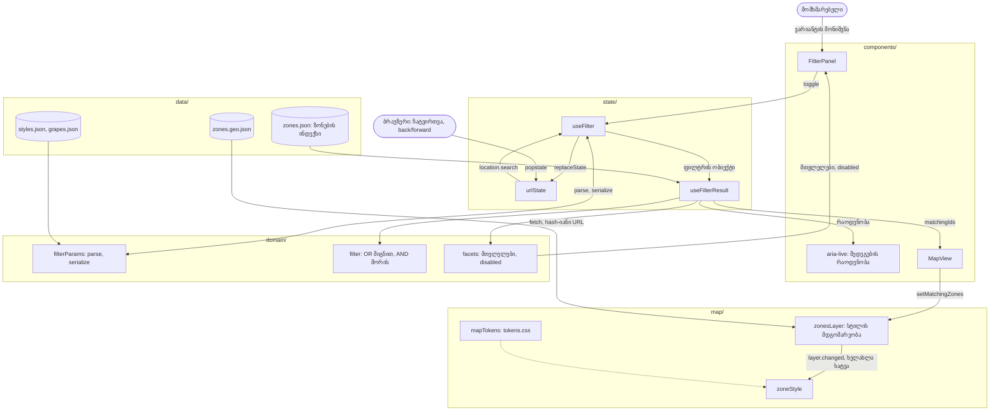
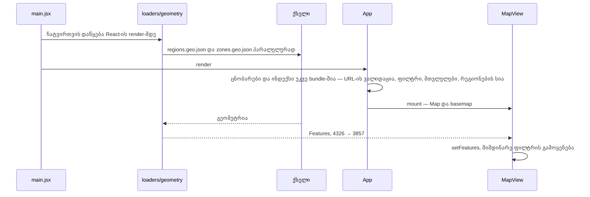

# 01 — არქიტექტურა
საქართველოს ღვინის რუკა · v1
ბოლო განახლება: 2026-11-18 (ეტაპი 4: საბაზისო რუკა)
სტატუსი: პროექტი. §10-ის პუნქტები დადასტურებამდე წინადადებად ითვლება.

---

## 1. პრინციპები

1. **სამი ფენა, ცალმხრივი დამოკიდებულება.** `components/ → state/ → domain/` და ცალკე `components/MapView → map/`. `domain/` არაფერს აიმპორტებს React-იდან ან ol-იდან, `map/` კი React-იდან. ამიტომ ფილტრის ლოგიკა Vitest-ით DOM-ისა და canvas-ის გარეშე ტესტდება.
2. **ფილტრის ერთადერთი წყარო URL-ია** (§5).
3. **მონაცემი უცვლელია.** ერთხელ იტვირთება და runtime-ში არ იცვლება. შესაბამისი ზონები და მთვლელები მისგან და URL-იდან გამოითვლება, არსად ინახება.
4. **რუკა იმპერატიულია, UI დეკლარაციული.** მათ შორის ერთი ხიდია, `MapView`. ol-ის ობიექტები React state-ში არ ხვდება.
5. **რუკის ყოველ მოქმედებას DOM-ში აქვს ეკვივალენტი** (რეგიონების სია, ფილტრი, ღილაკები), რადგან canvas ეკრანის წამკითხველისთვის და კლავიატურისთვის მიუწვდომელია. WCAG 2.2 AA.
6. **UI-ის ყველა ტექსტი ერთ ფაილშია** (`src/copy/ka.js`), რომ ინგლისური ვერსია მოგვიანებით ახალი ფაილის დამატება იყოს და არა რეფაქტორი.

---

## 2. ფაილების ხე

```
map_2/
├── index.html
├── package.json
├── vite.config.js                # Vite + Vitest (test ველი, ცალკე config-ის გარეშე)
├── eslint.config.js              # Vite-ის შაბლონიდან
├── netlify.toml | vercel.json    # ჰოსტინგი, header-ები; არჩევანი ეტაპ 9-ზე
├── scripts/                      # მონაცემების აწყობა და ვალიდაცია (ჩატი 3); bundle-ში არ შედის
├── public/
│   └── favicon.svg
└── src/
    ├── main.jsx                  # entry: CSS, StrictMode, გეომეტრიის ჩატვირთვის დაწყება
    ├── App.jsx                   # layout: რუკა + პანელები
    ├── App.module.css            # ბადე: მობილურზე ერთი უჯრა, desktop-ზე ორი სვეტი; --map-inset-bottom
    │
    ├── styles/
    │   ├── tokens.css            # ჩატი 2 — ფერის, spacing-ის, radius-ის, შრიფტის ერთადერთი წყარო
    │   └── global.css            # reset, საბაზისო ტიპოგრაფია, .map-button, ol.css-ის override-ები
    │
    ├── copy/
    │   └── ka.js                 # UI-ის ყველა სტრიქონი (04-copy-voice.md)
    │
    ├── data/                     # ჩატი 3-ის შედეგი; აპისთვის მხოლოდ წასაკითხი
    │   ├── styles.json           # სტილების ცნობარი: slug, UI-ის სახელი, სინონიმები
    │   ├── grapes.json           # ჯიშების ცნობარი
    │   ├── regions.json          # რეგიონების ატრიბუტები (გეომეტრიის გარეშე)
    │   ├── zones.json            # ზონების ინდექსი: ატრიბუტები + კავშირები (გეომეტრიის გარეშე)
    │   ├── regions.geo.json      # ADM1 გეომეტრია
    │   └── zones.geo.json        # ზონების გეომეტრია (MultiPolygon)
    │
    ├── loaders/
    │   ├── catalogs.js           # styles, grapes, regions, zones index — სტატიკური import
    │   └── geometry.js           # *.geo.json — fetch hash-იანი URL-ით, promise cache, retry
    │
    ├── domain/                   # სუფთა ფუნქციები: React-ისა და ol-ის გარეშე
    │   ├── filter.js             # ზონა ↔ ფილტრი: OR განზომილების შიგნით, AND შორის
    │   ├── filter.test.js
    │   ├── facets.js             # ვარიანტების მთვლელები და disabled მდგომარეობა
    │   ├── facets.test.js
    │   ├── filterParams.js       # URL query ↔ ფილტრის ობიექტი, ვალიდაცია, კანონიკური ფორმა
    │   ├── filterParams.test.js
    │   └── catalog.js            # ძებნა id-ით, სინონიმებით ძებნა ვარიანტებში
    │
    ├── state/
    │   ├── urlState.js           # ერთადერთი მოდული, რომელიც window.history-ს ეხება
    │   ├── useFilter.js          # ფილტრი URL-იდან + მოქმედებები
    │   ├── useSelectedZone.js    # არჩეული ზონა URL-იდან (წინადადება, §5)
    │   └── useFilterResult.js    # წარმოებული: შესაბამისი ზონები + მთვლელები
    │
    ├── map/                      # მხოლოდ OpenLayers; React-ის გარეშე
    │   ├── createMap.js          # Map + View + controls; აბრუნებს რუკის კონტროლერს
    │   ├── basemaps.js           # XYZ კონფიგურაცია: Light, Terrain, Imagery
    │   ├── interactions.js       # click → ზონის id; hover შიგნითვე, React-ის გარეშე
    │   ├── layers/
    │   │   ├── regionsLayer.js
    │   │   └── zonesLayer.js     # ფლობს სტილის მდგომარეობას; ცვლილება → layer.changed()
    │   └── styles/
    │       ├── regionStyle.js
    │       ├── zoneStyle.js      # active / dimmed / selected / hover; პოლიგონი ან ცენტროიდის მარკერი
    │       └── mapTokens.js      # tokens.css → getComputedStyle; ეტაპ 4-ზე: რეგიონები და motion
    │
    ├── components/               # თითო ფოლდერში Component.jsx + Component.module.css
    │   ├── MapView/              # MapView.jsx + MapContext.js; ფლობს კონტროლერის ref-ს; state → map-ის ერთადერთი ხიდი
    │   ├── FilterPanel/
    │   ├── ZonePanel/
    │   ├── RegionList/
    │   ├── BasemapSwitcher/
    │   └── BottomSheet/          # მობილურის კონტეინერი FilterPanel-ისა და ZonePanel-ისთვის
    │
    └── hooks/
        └── useMediaQuery.js      # მხოლოდ იქ, სადაც ქცევა და არა მხოლოდ ვიზუალი იცვლება
```

**სტილები:** CSS Modules (Vite-ში ჩაშენებულია, დამოკიდებულება არ სჭირდება). ყოველი მნიშვნელობა `tokens.css`-ის ცვლადიდან.

---

## 3. მოდულები

| მოდული | პასუხისმგებლობა | დამოკიდებულებები |
|---|---|---|
| **Map core** · `map/createMap.js` | ქმნის `Map`-ს და `View`-ს (EPSG:3857, საწყისი ხედი საქართველოზე), controls (zoom, attribution), ფენების რიგს zIndex-ით: basemap → რეგიონები → ზონები. აბრუნებს **რუკის კონტროლერს**: `setMatchingZones`, `setSelectedZone`, `setBasemap`, `fitToExtent`, `setFeatures`, `destroy`. React-ს არ იცნობს. **ეტაპ 4-ზე არსებობს:** `setFeatures({ regions })`, `setBasemap(id)`, `fitToExtent(extent, { padding, animate })`, `destroy()` (`setTarget(undefined)` + `dispose()`). View-ს ცენტრი არ აქვს პირველ `fitToExtent`-მდე; zoom 5–15; როტაცია გამორთულია. Zoom და Attribution კონტროლები MapView-ის მიწოდებულ ელემენტებში იხატება (`target`). | `ol/Map`, `ol/View`, `ol/control`, `map/basemaps`, `map/layers/*`, `map/interactions` |
| **Basemaps** · `map/basemaps.js` | XYZ წყაროების სია სამი სლოტით (`light`, `terrain`, `imagery`): `id`, `url`, `attribution`, `subdomains`, `maxZoom`, `key { placeholder, env }`. ქართული სახელი `copy/ka.js`-შია (`basemap.names[id]`). `url` და `attribution` სიიდან უცვლელად იწერება; Leaflet-ის `{s}`/`{r}` და გასაღების ჩასმა კოდში ხდება (`buildUrlOptions`). ყველა ფენა ერთხელ იქმნება, გადართვა `setVisible`-ია. ფენები და პირობები: 06-data-sources.md §8. გასაღები `import.meta.env.VITE_*`-დან (ის კლიენტის bundle-ში ჩანს, ამიტომ დომენზე შეზღუდული უნდა იყოს). | `ol/layer/Tile`, `ol/source/XYZ` |
| **Layers** · `map/layers/regionsLayer.js` | ADM1 vector ფენა. ცალკე სტილის მდგომარეობა (მაგ. ფოკუსში მყოფი რეგიონი). აფხაზეთისა და ცხინვალის რეგიონის ჩვენების წესისთვის ადგილი რჩება (ჩატი 3). | `ol/layer/Vector`, `ol/source/Vector`, `map/styles/regionStyle` |
| **Layers** · `map/layers/zonesLayer.js` | ზონების vector ფენა რეგიონების ზემოთ. ფლობს **სტილის მდგომარეობას** `{ matchingIds, selectedId, hoveredId }`. ყოველი ცვლილება: მდგომარეობის განახლება + `layer.changed()`. ფენა და features ხელახლა არ იქმნება. | `ol/layer/Vector`, `ol/source/Vector`, `map/styles/zoneStyle` |
| **Layers** · `map/styles/zoneStyle.js` | style function: აქტიური / ჩამქრალი / არჩეული / hover. ეკრანზე პატარა ზონას (bbox პიქსელებში ზღვარზე ნაკლები) ხატავს **ცენტროიდის მარკერად** იმავე feature-ზე, `labelPoint`-იდან. Style ობიექტების cache. ზღვარი: ეტაპი 5. | `ol/style/*`, `map/styles/mapTokens` |
| **Layers** · `map/styles/mapTokens.js` | ერთადერთი ადგილი, საიდანაც style function-ები ფერს იღებენ: `readMapTokens()` კითხულობს `tokens.css`-ს `getComputedStyle`-ით (§8). ეტაპ 4-ზე: `region` ჯგუფი და `motion.mapDuration`; ზონის ტოკენები ეტაპ 5-ზე ემატება. | `tokens.css` |
| **Layers** · `map/interactions.js` | `singleclick` → ზონის id → `onZoneClick` callback. hover (მხოლოდ pointer მოწყობილობაზე) პირდაპირ `zonesLayer`-ს ცვლის, React-ის გავლით არა. `hitTolerance` შეხებისთვის, მარკერის მიზანი ≥ 24×24 CSS px (WCAG 2.5.8). | `ol/Map` events |
| **Data loading** · `loaders/catalogs.js` | სტატიკური import: `styles.json`, `grapes.json`, `regions.json`, `zones.json`. აწვდის Map-ებს id-ით (lookup). სინქრონულად ხელმისაწვდომია პირველივე render-ზე. | `src/data/*.json` |
| **Data loading** · `loaders/geometry.js` | `*.geo.json` hash-იანი URL-ით (`?url`) და `fetch`-ით. ჩატვირთვა `main.jsx`-დან იწყება, React-ის render-მდე, პარალელურად. promise cache (ერთი მოთხოვნა ფაილზე), GeoJSON → Features (4326 → 3857), შეცდომა + retry. აბრუნებს `{ features, extent }`; ჩავარდნილი მოთხოვნა cache-დან იშლება, რომ შემდეგმა გამოძახებამ თავიდან სცადოს. ეტაპ 4-ზე: `loadRegionGeometry()`. | `fetch`, `ol/format/GeoJSON` |
| **Filter state** · `domain/filter.js` | `matches(zone, filter)`: ყოველი არაცარიელი განზომილება — თანაკვეთა ≠ ∅ (OR), ყველა განზომილება ერთად (AND). ცარიელი ფილტრი = ყველა ზონა აქტიურია. | — |
| **Filter state** · `domain/facets.js` | ყოველი ვარიანტის მთვლელი: ზონები, რომლებიც **სხვა** განზომილებების ფილტრს აკმაყოფილებს და ამ ვარიანტს შეიცავს. ვარიანტი disabled-ია, თუ მთვლელი 0-ია და ვარიანტი მონიშნული არ არის. მონიშნული ვარიანტი არასოდეს გამოირთვება, რომ მოხსნა შეიძლებოდეს. | `domain/filter` |
| **Filter state** · `domain/filterParams.js` | `parse`: URL → ფილტრის ობიექტი; უცნობი slug-ები და დუბლიკატები იშლება. `serialize`: ფილტრი → კანონიკური query (მნიშვნელობები დალაგებული, ცარიელი განზომილება გამოტოვებული, გასაღებების რიგი `style`, `grape`, `zone`). | `loaders/catalogs` (ცნობარები ვალიდაციისთვის) |
| **Filter state** · `state/useFilter.js` | hook: ფილტრი URL-იდან (`useSyncExternalStore`, snapshot = `location.search` სტრიქონი), parse მემოიზებულია სტრიქონის მიხედვით. მოქმედებები: `toggle(dimension, slug)`, `clear(dimension?)` → `urlState.replace`. | `state/urlState`, `domain/filterParams` |
| **Filter state** · `state/useFilterResult.js` | წარმოებული მონაცემი `useMemo`-თი: `matchingIds` (Set ან `null`, თუ ფილტრი ცარიელია), მთვლელები, შედეგების რაოდენობა. არაფერს ინახავს. | `domain/filter`, `domain/facets`, `loaders/catalogs` |
| **URL sync** · `state/urlState.js` | ერთადერთი მოდული, რომელიც `window.history`-ს ეხება: `read`, `subscribe`, `replace`, `push`. ისმენს `popstate`-ს (back/forward) და საკუთარ ჩაწერებზე თავად აგზავნის შეტყობინებას (`pushState`/`replaceState` `popstate`-ს არ იწვევს). ცვლის მხოლოდ საკუთარ გასაღებებს, უცნობ პარამეტრებს (utm და სხვ.) ტოვებს. ჩატვირთვისას URL-ს კანონიკურ ფორმამდე ასწორებს `replaceState`-ით. | `window.history`, `window.location` |
| **URL sync** · `state/useSelectedZone.js` | არჩეული ზონა URL-იდან (`zone=`); `select(id)` → `push`, `close()` → `replace`. უცნობი id → პანელი დახურულია, პარამეტრი იშლება. | `state/urlState`, `loaders/catalogs` |
| **UI** · `components/MapView` | ფლობს `mapRef`-ს: Map იქმნება `useEffect`-ში, cleanup-ზე `map.setTarget(undefined)` და ref-ის გასუფთავება. effect-ები აკავშირებს state-ს კონტროლერთან: `matchingIds` → `setMatchingZones`, არჩეული ზონა → `setSelectedZone` + `fitToExtent`. callback-ები ref-შია, რომ Map ხელახლა არ შეიქმნას. `MapContext` აწვდის კონტროლერის ref-ს (სტაბილური ობიექტი, re-render-ს არ იწვევს) და ცალკე ფაილშია (`MapContext.js`). **ეტაპ 4:** საწყისი ხედი რეგიონების extent-იდან მოდის (`fitToExtent`); padding overlay-ს გამოთვლილი padding-ია (რუკის კიდე + `--map-inset-bottom`). ჩატვირთვის მდგომარეობა `role="status"` ფირფიტაზე ჩანს, შეცდომისას „თავიდან ცდა“. | `map/createMap`, `state/*`, `loaders/geometry` |
| **UI** · `components/FilterPanel` | სტილისა და ჯიშის ვარიანტები ნატიური form controls-ით, მთვლელი ყოველ ვარიანტთან, disabled მდგომარეობა, „გასუფთავება“. შედეგების რაოდენობა `aria-live` რეგიონში. ძიება სინონიმებით (`orange wine` → ქარვისფერი), თუ ძიების ველი v1-ში შევა (ეტაპი 6). | `state/useFilter`, `state/useFilterResult`, `domain/catalog`, `copy/ka` |
| **UI** · `components/ZonePanel` | არჩეული ზონა: სახელი, რეგიონი, ჯიშები, სტილები, წყარო. `source`-ისა და `verified`-ის ჩვენების წესი: ეტაპი 7. დახურვა + ფოკუსის დაბრუნება. | `state/useSelectedZone`, `loaders/catalogs`, `copy/ka` |
| **UI** · `components/RegionList` | რეგიონები და მათი ზონები DOM სიად: რუკის ხელმისაწვდომი ეკვივალენტი. რეგიონი → `fitToExtent` (კონტროლერი `MapContext`-იდან), ზონა → `select`. ფილტრით ჩამქრალი ზონები აქაც ჩამქრალია, არა დამალული. | `loaders/catalogs`, `state/*`, `MapContext` |
| **UI** · `components/BasemapSwitcher` | საბაზისო ფენის არჩევა (local state) → `setBasemap`. ღილაკი + Popover API (`popover="auto"`), შიგნით radio ჯგუფი `BASEMAPS`-იდან. ბრაუზერში CSS anchor positioning-ის გარეშე popover ეკრანის ცენტრში იხსნება. | `MapContext`, `map/basemaps`, `copy/ka` |
| **UI** · `components/BottomSheet` | მობილურზე FilterPanel-ისა და ZonePanel-ის კონტეინერი, desktop-ზე გვერდითი პანელი. რაც შეიძლება CSS-ით; JS (`useMediaQuery`) მხოლოდ ქცევისთვის (ფოკუსი, drag). | `hooks/useMediaQuery`, `tokens.css` |

---

## 4. მონაცემთა ნაკადი: ფილტრიდან ზონების შრემდე



**ნაბიჯები:**

1. **ცვლილება.** მომხმარებელი FilterPanel-ში ვარიანტს მონიშნავს → `useFilter.toggle` → `filterParams.serialize` → `urlState.replace`.
2. **შეტყობინება.** `urlState` აცნობებს გამომწერებს. back/forward და პირველი ჩატვირთვა იმავე გზით მოდის (`popstate` / საწყისი წაკითხვა).
3. **წაკითხვა.** `useFilter` კითხულობს `location.search`-ს, `filterParams.parse` ამოწმებს ცნობარებით → ფილტრის ობიექტი.
4. **გამოთვლა.** `useFilterResult` ზონების ინდექსიდან ითვლის `matchingIds`-ს და მთვლელებს.
5. **UI.** FilterPanel იღებს მთვლელებს და disabled მდგომარეობას; `aria-live` აცხადებს შედეგების რაოდენობას.
6. **რუკა.** `MapView`-ის effect იძახებს `setMatchingZones`-ს → `zonesLayer` ანახლებს სტილის მდგომარეობას → `layer.changed()` → style function ყოველ feature-ს ხელახლა აფასებს: აქტიური ან ჩამქრალი. ფენა, source და features არ იცვლება.

### საწყისი ჩატვირთვა



ფილტრი და რეგიონების სია გეომეტრიის მოსვლამდე მუშაობს. თუ გეომეტრია ვერ ჩაიტვირთა, ფილტრი და სია მაინც მუშაობს, რუკაზე კი შეტყობინება და „თავიდან ცდა“ ჩანს.

---

## 5. State-ის მართვა

**არის თუ არა URL ფილტრის ერთადერთი წყარო? დიახ.** ფილტრის მნიშვნელობა მხოლოდ URL-შია, React state-ში მისი ასლი არ ინახება.

რატომ:
- **გაზიარება და reload.** ბმული `?style=amber` ზუსტად იმავე მდგომარეობას ხსნის. ეს მიღებული გადაწყვეტილებაა.
- **ორი წყარო = desync.** თუ ფილტრი state-შიც იქნება და URL-შიც, ორმხრივი სინქრონიზაცია ციკლებსა და back ღილაკის ბაგებს იწვევს. ერთი წყაროს შემთხვევაში back/forward უფასოდ მუშაობს.
- **ერთი შესასვლელი.** პირველი ჩატვირთვა, მომხმარებლის მოქმედება და back/forward ერთი გზით გადის (§4).
- **ტესტირებადობა.** `parse`/`serialize` სუფთა ფუნქციებია: URL-ის ყველა ზღვრული შემთხვევა DOM-ის გარეშე ტესტდება.

რა სად ინახება:

| მდგომარეობა | სად | რატომ |
|---|---|---|
| ფილტრი (`style`, `grape`) | URL, `replaceState` | გაზიარება, reload. ყოველი მონიშვნა ისტორიის ჩანაწერს არ ქმნის, back გვერდიდან გადის |
| არჩეული ზონა (`zone`) | URL, `pushState` (**წინადადება**) | ბმული კონკრეტულ ზონაზე; მობილურზე back ხურავს bottom sheet-ს |
| შესაბამისი ზონები, მთვლელები | `useMemo` | წარმოებულია; შენახვა desync-ს შექმნიდა |
| hover | `map/` შიგნით | ყოველ მოძრაობაზე React-ის re-render ზედმეტია |
| sheet-ის მდგომარეობა, basemap | კომპონენტის local state | ეფემერულია, ბმულში ზედმეტია |
| რუკის ხედი (center/zoom) | OL `View` | ხშირად იცვლება; ბრაუზერები (მაგ. Safari) history API-ის ხშირ გამოძახებას ზღუდავენ |
| მონაცემები | `loaders/` (bundle + promise cache) | უცვლელია |

**გლობალური state ბიბლიოთეკა არ გვჭირდება:** state = URL + რამდენიმე local მნიშვნელობა.

URL-ის წესები:
- ფორმა: `?style=amber&grape=rkatsiteli,saperavi&zone=napareuli`. რამდენიმე მნიშვნელობა მძიმით (**დადასტურებულია**). `zone=` ჯერ წინადადებაა (§10).
- `URLSearchParams` მძიმეს `%2C`-ად აკოდირებს, ამიტომ `serialize` სტრიქონს თავად აწყობს (slug-ები მხოლოდ `a-z`, `0-9`, `-`-ია, ასე რომ ეს უსაფრთხოა). `parse` იღებს მძიმეს, `%2C`-ს და გამეორებულ გასაღებებსაც, აბრუნებს კი მხოლოდ კანონიკურ ფორმას.
- query-ზე დაფუძნებულ URL-ებს SPA redirect მკაცრად არ სჭირდება (მოთხოვნა მაინც `/`-ზე მოდის). redirect რჩება იმ შემთხვევისთვის, თუ path-ები გაჩნდება (მაგ. `/en/`).

---

## 6. მონაცემების ჩატვირთვა

| მიდგომა | + | − |
|---|---|---|
| `fetch` `public/`-დან | JS bundle-ში არ შედის; პარალელური ჩატვირთვა | ფაილის სახელს hash არ აქვს: ან მოკლე cache (მობილურზე ყოველ ვიზიტზე თავიდან ჩამოტვირთვა), ან deploy-ის შემდეგ ძველი მონაცემი; ვერსიონირება ხელით |
| სტატიკური `import` bundle-ში | სინქრონულია, loading მდგომარეობა არ სჭირდება | დიდი GeoJSON JS-ის parse-ს ამძიმებს და პირველ render-ს აყოვნებს; კოდის ნებისმიერი ცვლილება მონაცემის cache-საც აუქმებს |
| დინამიკური `import()` | ცალკე chunk, lazy | GeoJSON მაინც JS მოდულად იქცევა; `fetch`-თან შედარებით უპირატესობა არ აქვს |
| **`?url` import + `fetch`** | hash-იანი სახელი → გრძელვადიანი immutable cache; JS bundle-ში არ შედის; ჩატვირთვა ადრე და პარალელურად იწყება | loading და error მდგომარეობა სჭირდება |

**გადაწყვეტილება (წინადადება):**
- **ცნობარები და ინდექსი** (`styles.json`, `grapes.json`, `regions.json`, `zones.json`) → სტატიკური import. პატარაა და სინქრონულად გვჭირდება: URL-ის ვალიდაციას, მთვლელებსა და რეგიონების სიას პირველივე render-ზე.
- **გეომეტრია** (`*.geo.json`) → `?url` + `fetch`. ფაილები `src/data/`-შია და არა `public/`-ში, რომ Vite-მა hash დაადოს.
- გეომეტრიის ფაილები მხოლოდ `?url`-ით იმპორტდება; ჩვეულებრივი import მათ bundle-ში ჩაიტანდა.

**მობილური ინტერნეტი:**
- ჩატვირთვა იწყება `main.jsx`-დან, `useEffect`-ის მოლოდინის გარეშე.
- გაფართოება `.geo.json`: ჰოსტი `application/json`-ს აბრუნებს და კუმშავს (gzip/brotli). `.geojson`-ის MIME ტიპი შეიძლება ავტომატურად არ შეიკუმშოს. **ეტაპ 9-ზე შესამოწმებელია.**
- ზომის ბერკეტები (ჩატი 3): გეომეტრიის გამარტივება, კოორდინატების სიზუსტე, ზედმეტი properties-ის მოშორება გეომეტრიის ფაილებიდან.
- v1-ში არ შედის: ორდონიანი გეომეტრია (დაბალი/მაღალი zoom), service worker, vector tiles. გადახედვა ეტაპ 9-ზე, გაზომვის შემდეგ.
- ზომის ბიუჯეტი ეტაპ 9-ზე დგინდება.

**გავლენა მონაცემთა მოდელზე (02-data-model.md):**
- ზონა და რეგიონი ორ ფაილად: ატრიბუტები (`zones.json`, `regions.json`) და გეომეტრია (`*.geo.json`). კავშირი `id`-ით (slug); გეომეტრიის ფაილში GeoJSON Feature-ის `id` = slug.
- ინდექსში წინასწარ გამოთვლილი `labelPoint` (ცენტროიდის მარკერისთვის) და `bbox` (`fitToExtent`-ისთვის). runtime-ში არ ითვლება.
- ორ ფაილს შორის თანხვედრას ამოწმებს ჩატი 3-ის ვალიდაციის სკრიპტი.
- თუ ზონის პანელის ტექსტები (ეტაპი 7) გაიზრდება, ისინი ინდექსიდან ცალკე, lazy ფაილში გადავა.

---

## 7. რატომ ინახება Map ინსტანცია `useRef`-ში და არა state-ში

1. **Map არ არის render-ის მონაცემი.** ის მუტირებადი, იმპერატიული ობიექტია საკუთარი სასიცოცხლო ციკლით. JSX მასზე არ არის დამოკიდებული, ამიტომ მისი შეცვლა re-render-ს არ უნდა იწვევდეს. state კი ზუსტად ამისთვისაა.
2. **სტაბილური იდენტობა re-render-ის გარეშე.** ref ყველა render-ში ერთი და იგივეა და effect-ებსა და handler-ებში ხელმისაწვდომია. dependency array-ები Map-ის გამო არ იცვლება.
3. **render სუფთა უნდა იყოს.** Map-ის შექმნა გვერდით ეფექტია (DOM, listener-ები). `useState(() => new Map(...))` render-ის დროს გაეშვება, StrictMode-ში კი ორჯერ: ერთი ინსტანცია მიტოვებული დარჩება მიბმული listener-ებით.
4. **StrictMode-ის ორმაგი mount.** dev რეჟიმში mount → cleanup → mount. Map იქმნება `useEffect`-ში, cleanup ასრულებს `map.setTarget(undefined)`-ს და ref-ს ასუფთავებს, მეორე mount კი სუფთად ქმნის ახალს. ერთდროულად ერთზე მეტი ინსტანცია არასოდეს არსებობს.
5. **ძველი closure-ები.** state-ში შენახული ობიექტი callback-ებში ძველი მნიშვნელობით „იჭედება“. ref ყოველთვის მიმდინარეს აჩვენებს.

სხვა კომპონენტები რუკას `MapContext`-ით აღწევენ: კონტექსტში ref-ია (სტაბილური), ამიტომ re-render არ ხდება. კონტროლერის მეთოდები მხოლოდ event handler-ებსა და effect-ებში გამოიძახება, render-ში არასოდეს. თუ კომპონენტს „რუკა მზადაა“ სჭირდება, ეს ცალკე boolean state-ია, არა თავად Map.

---

## 8. ზონების ფერები: ადგილი ჩატი 2-სთვის

**განახლება (ჩატი 2, ეტაპი 4):** მიდგომა დაფიქსირდა: `tokens.css` → `getComputedStyle` → `map/styles/mapTokens.js` (ადრე `mapColors.js`). ქვემოთ ჩამოთვლილი საზღვრები ძალაში რჩება.

თავდაპირველი ტექსტი: მიდგომა **არ** ფიქსირდება. ფიქსირდება მხოლოდ საზღვრები:

- `map/styles/mapTokens.js` ერთადერთი მოდულია, საიდანაც `zoneStyle` და `regionStyle` ფერს იღებენ. სხვაგან ფერი არ ჩნდება.
- **შეზღუდვა:** OpenLayers canvas-ზე ხატავს და სტილში გამოთვლილ ფერის სტრიქონს იღებს, არა `var(--…)`-ს. ნებისმიერ მიდგომაში მნიშვნელობა Style ობიექტების შექმნამდე უნდა იყოს გამოთვლილი. თუ ფერები runtime-ში შეიცვლება (მაგ. თემა), საჭიროა Style cache-ის გასუფთავება და `layer.changed()`.
- **მდგომარეობები, რომლებსაც ფერი სჭირდება** (ჩამონათვალი ფიქსირდება, ფერები არა): ზონა აქტიური / ჩამქრალი / არჩეული / hover; ცენტროიდის მარკერი აქტიური / ჩამქრალი; რეგიონის საზღვარი და შევსება; რეგიონის განსაკუთრებული სტატუსი (ჩატი 3).
- ფერის ლოგიკა (ერთი ფერი ყველა ზონისთვის, რეგიონის მიხედვით თუ სხვა) და ჩამქრალი ზონის კონტრასტი ფონთან: ჩატი 2.

---

## 9. დამოკიდებულებები

### საჭირო

| პაკეტი | ტიპი | რისთვის | სტატუსი |
|---|---|---|---|
| `react`, `react-dom` | runtime | UI | Vite-ის შაბლონი |
| `ol` | runtime | რუკა; import მხოლოდ საჭირო მოდულებიდან + `ol/ol.css` | სტეკის გადაწყვეტილება |
| `vite`, `@vitejs/plugin-react` | dev | build, dev server | Vite-ის შაბლონი |
| ESLint ნაკრები | dev | lint, `react-hooks` წესები | Vite-ის შაბლონი |
| `vitest` | dev | unit ტესტები; config `vite.config.js`-ში | **ახალი**, მოთხოვნილი |
| `jsdom` | dev | DOM გარემო `state/` hook-ებისა და კომპონენტების ტესტებისთვის. `domain/` ტესტები node გარემოში რჩება (გარემო ფაილის დონეზე) | **ახალი, შენი თანხმობა სჭირდება** |
| `@testing-library/react` + `@testing-library/dom` | dev | FilterPanel-ის ტესტი როლებით: მთვლელები, disabled, aria-live. ეს a11y კონტრაქტსაც ამოწმებს. `dom` peer დამოკიდებულებაა | **ახალი, შენი თანხმობა სჭირდება** |

არასავალდებულო, ეტაპ 6-ზე: `@testing-library/user-event` (რეალისტური კლავიატურის მოქმედებები) და `@testing-library/jest-dom` (მოსახერხებელი matcher-ები). მათ გარეშეც შეიძლება.

**ტესტების სტრატეგია მოკლედ:** მთავარი დაფარვა `domain/`-ზე (OR/AND, მთვლელები, URL-ის ზღვრული შემთხვევები). `map/styles/` style function-ები მოწმდება ol-ის Feature ობიექტებით, რენდერის გარეშე. რუკის რენდერი jsdom-ში არ მუშაობს (canvas), ამიტომ მოწმდება ხელით.

### ზედმეტი

| პაკეტი | რატომ არა | როდის გადავხედოთ |
|---|---|---|
| `react-router` | ერთი ეკრანია; query-ს `urlState` მართავს history API-ით | path-ები (`/en/`, `/zone/…`) ინგლისური ვერსიისთვის ან SEO-სთვის |
| Redux, Zustand, Jotai | state = URL + რამდენიმე local მნიშვნელობა | თუ გლობალური state URL-ს გასცდება |
| `rlayers` და სხვა React-ol wrapper-ები | სასიცოცხლო ციკლს მალავს და `layer.changed()`-ის წესს ეწინააღმდეგება | — |
| `proj4` | EPSG:4326 და 3857 ol-ში ჩაშენებულია | თუ წყაროს მონაცემი სხვა CRS-შია: გარდაქმნა ჩატი 3-ის სკრიპტებში, არა აპში |
| `@turf/turf` (runtime) | `labelPoint` და `bbox` წინასწარ ითვლება; extent ol-შიცაა | ჩატი 3-ის სკრიპტებში, dev-only, შესაძლოა |
| `axios` | `fetch` საკმარისია | — |
| Tailwind, CSS-in-JS, UI kit | `tokens.css` + CSS Modules | — |
| bottom sheet ბიბლიოთეკა | a11y-ისა და ზომის კონტროლი; ნატიური `dialog` + CSS | ეტაპი 8, თუ drag ჟესტები რთული აღმოჩნდა |
| i18n ბიბლიოთეკა | ინგლისური v1-ში არ შედის; სტრიქონები `copy/ka.js`-შია | ინგლისური ვერსია |
| `vite-plugin-pwa` / service worker | v1-ის ფარგლებს გარეთაა | ეტაპი 9, გაზომვის შემდეგ |
| Playwright / e2e | v1: unit + კომპონენტის ტესტები | ეტაპ 9-ის შემდეგ |
| TypeScript compiler | TypeScript მხოლოდ დოკუმენტაციისთვის | — |

---

## 10. გადაწყვეტილებები

### დადასტურებული
- **URL-ში რამდენიმე მნიშვნელობა მძიმით იწერება:** `grape=rkatsiteli,saperavi`. `serialize` სტრიქონს თავად აწყობს; `parse` იღებს მძიმეს, `%2C`-ს და გამეორებულ გასაღებებს, აბრუნებს მხოლოდ კანონიკურ ფორმას.

### დასადასტურებელი
1. **არჩეული ზონა URL-ში** (`zone=`, `pushState`), რომ back მობილურზე პანელს ხურავდეს.
2. **ატრიბუტებისა და გეომეტრიის გაყოფა** ორ ფაილად (ზონები და რეგიონები). 02-data-model.md ამას უნდა მიჰყვეს.
3. **ფილტრის განზომილებები v1-ში:** `style` და `grape`. რეგიონი ნავიგაციაა (სია, `fitToExtent`), არა ფილტრის განზომილება. **დაშვება.**
4. **მთვლელების სემანტიკა:** ვარიანტის მთვლელი სხვა განზომილებების ფილტრით ითვლება; მონიშნული ვარიანტი არასოდეს გამოირთვება.
5. **CSS Modules** კომპონენტების სტილისთვის.
6. **ახალი dev დამოკიდებულებები:** `jsdom`, `@testing-library/react`, `@testing-library/dom`.

### ეტაპ 4-ის დამატებები (დასადასტურებელი)
1. **`components/MapView/MapContext.js`** ცალკე ფაილია: კომპონენტისა და context-ის ერთი ფაილიდან ექსპორტი fast refresh-ს აფუჭებს.
2. **`--map-inset-bottom`**: layout-ის ცვლადი `App.module.css`-ში და არა დიზაინის ტოკენი. აღნიშნავს რუკის იმ სიმაღლეს, რომელსაც bottom sheet ფარავს; MapView ღილაკებს, attribution-ს და fit-ის padding-ს მის ზემოთ ათავსებს. sheet მას თავისი მდგომარეობით განაახლებს (ეტაპი 8).
3. **`.map-button`**: გლობალური კლასი `global.css`-ში, საერთო basemap-ის ღილაკისა (React) და OpenLayers-ის zoom ღილაკებისთვის.
4. **Zoom და Attribution** OpenLayers-ის კონტროლებია, `target`-ით MapView-ის ელემენტებში. ამიტომ `destroy()` `map.dispose()`-საც იძახებს, თორემ StrictMode-ში ღილაკები დუბლირდება.
5. **`loaders/geometry`** აბრუნებს `{ features, extent }`: extent ჩატვირთვისას ითვლება, MapView ol-ს არ აიმპორტებს.
6. **ხედის ზღვრები:** zoom 5–15 (დაშვება), როტაცია გამორთულია, რეგიონების ჩატვირთვამდე რუკა არაფერს ხატავს.
7. **Lint:** ESLint flat config, როგორც §2-შია. Vite-ის ამჟამინდელი შაბლონი oxlint-ს იყენებს; არჩევანი ESLint-ზე დარჩა, `scripts/**` Node-ის გლობალებით.
8. **`MapContext`-ის არე:** ახლა მხოლოდ MapView-ის შიგნით მოქმედებს. RegionList პანელშია და მასაც დასჭირდება; provider-ის ადგილი ეტაპ 5–6-ზე გადასაწყვეტია.

### იმპლემენტაციისას შესამოწმებელი
- Netlify/Vercel კუმშავს თუ არა `.geo.json`-ს (ეტაპი 9).
- `?url` import `.json` გაფართოებაზე hash-იან asset URL-ს აბრუნებს და ფაილს bundle-ში არ რთავს (ეტაპი 5, `dist/`-ის შემოწმებით). **ეტაპ 4-ზე შემოწმდა** სატესტო ფაილით: hash-იანი asset გამოდის და JS bundle-ში არ ხვდება. 4 KB-ზე პატარა ფაილს Vite `data:` URI-დ ჩასვამს (`assetsInlineLimit`); ამჟამინდელი placeholder ასეთია, ნამდვილი გეომეტრია არა.

---

## 11. ტერმინები (წინადადება, 04-copy-voice.md-ის გლოსარიუმისთვის)

| ტერმინი | მნიშვნელობა |
|---|---|
| ზონების ინდექსი | `zones.json`: ზონების ატრიბუტები და კავშირები გეომეტრიის გარეშე |
| რუკის კონტროლერი | `createMap`-ის დაბრუნებული ობიექტი; React-იდან რუკაზე წვდომის ერთადერთი გზა |
| სტილის მდგომარეობა | `zonesLayer`-ის `{ matchingIds, selectedId, hoveredId }`, რომელსაც style function კითხულობს |
| მთვლელი | ფილტრის ვარიანტთან ნაჩვენები ზონების რაოდენობა |
| კანონიკური URL | ფილტრის ერთადერთი ჩაწერის ფორმა: დალაგებული, დუბლიკატებისა და უცნობი slug-ების გარეშე |
| წარმოებული მონაცემი | URL-იდან და ინდექსიდან გამოთვლილი, არსად შენახული (შესაბამისი ზონები, მთვლელები) |
